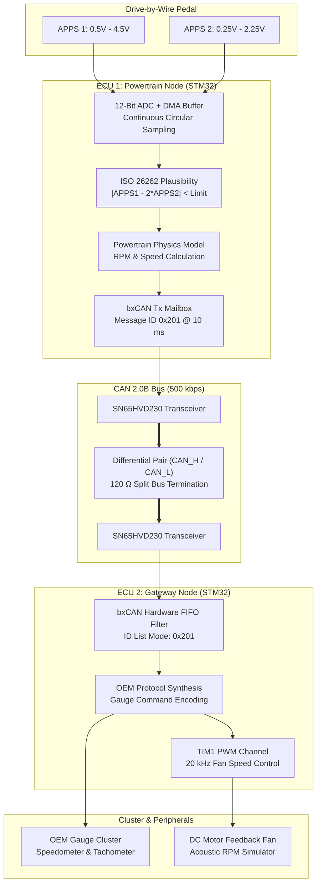

<div class="project-meta-strip">
  <div class="meta-item"><span class="meta-label">Domain:</span> <span class="meta-val">Automotive Embedded Systems</span></div>
  <div class="meta-item"><span class="meta-label">MCUs:</span> <span class="meta-val">Dual STM32 Nucleo (ARM Cortex-M)</span></div>
  <div class="meta-item"><span class="meta-label">Bus:</span> <span class="meta-val">CAN 2.0B (500 kbps), SPI, I2C, UART</span></div>
  <div class="meta-item"><span class="meta-label">Peripherals:</span> <span class="meta-val">OEM Instrument Cluster, DBW Pedal, Motor PWM</span></div>
</div>

## Overview

The **Automotive Mock Driving Simulator** is a Hardware-in-the-Loop (HIL) testbench designed to simulate real-world automotive powertrain electronic control units (ECUs). The system interfaces an OEM automotive instrument cluster and a drive-by-wire (DBW) accelerator pedal assembly with **dual STMicroelectronics STM32 microcontrollers** communicating over a high-speed **Controller Area Network (CAN 2.0B)** bus at 500 kbps.

<div class="tech-pill-container">
  <span class="tech-pill">STM32 / Cortex-M</span>
  <span class="tech-pill">CAN Bus 2.0B</span>
  <span class="tech-pill">Bare-Metal C</span>
  <span class="tech-pill">ADC DMA</span>
  <span class="tech-pill">Hardware Timers</span>
  <span class="tech-pill">HIL Testbench</span>
</div>

---

## Demonstration & Telemetry

<div class="video-showcase-container">
  <div class="video-showcase-header">
    <span>HIL Testbench & CAN Telemetry</span>
    <span style="font-weight: 400; color: var(--text-muted); font-size: 0.8rem;">Benchmark Run &bull; 500 kbps CAN 2.0B</span>
  </div>

  <div class="video-responsive-wrapper">
    <div class="video-placeholder-card">
      <div class="play-icon-box">
        <i class="fas fa-play"></i>
      </div>
      <h4>Distributed ECU Network & Cluster Actuation</h4>
      <p>
        Demonstrating instantaneous tachometer/speedometer gauge sweep, acoustic motor RPM feedback, and dynamic CAN frame decoding on a logic analyzer.
      </p>
    </div>
  </div>

  <div class="milestones-list">
    <div class="milestone-item">
      <span class="time-badge">0:04</span>
      <strong>Cold Startup & Handshake:</strong> ECUs initialize bxCAN hardware filters; 50 Hz cyclic heartbeat keeps cluster active.
    </div>
    <div class="milestone-item">
      <span class="time-badge">0:20</span>
      <strong>Drive-by-Wire Pedal Sweep:</strong> Dual APPS ADCs sample voltages; cluster needles sweep synchronously in under 8 ms.
    </div>
    <div class="milestone-item">
      <span class="time-badge">0:52</span>
      <strong>Acoustic Motor RPM:</strong> TIM1 complementary PWM drives fan motor proportional to simulated engine load.
    </div>
    <div class="milestone-item">
      <span class="time-badge">1:30</span>
      <strong>Fault Injection:</strong> Simulated potentiometer disconnect; firmware trips rationality check and clamps throttle within 20 ms.
    </div>
  </div>
</div>

---

## System Architecture

The testbench separates sensor processing and cluster actuation across two distinct physical ECUs connected via differential CAN signaling.



---

## Hardware Architecture & Electrical Interface

The circuit interfaces 3.3V STM32 Nucleo boards, 5V-tolerant CAN transceivers, a passive RC filter front-end for analog sensor conditioning, and an OEM 12V automotive gauge cluster.

### Interconnect & Pinout

| MCU Pin | Function | Connected Peripheral | Protocol | Voltage | Notes |
| :--- | :--- | :--- | :--- | :--- | :--- |
| <span class="pin-code">ECU1: PA0</span> | ADC1_IN0 | Accelerator Sensor 1 (APPS1) | Analog In | 0 &ndash; 3.3V Scaled | 1k&Omega; / 100nF RC low-pass filter |
| <span class="pin-code">ECU1: PA1</span> | ADC1_IN1 | Accelerator Sensor 2 (APPS2) | Analog In | 0 &ndash; 3.3V Scaled | 1:2 ratio monitoring for plausibility |
| <span class="pin-code">ECU1: PB9</span> | CAN1_TX | SN65HVD230 Transceiver D Pin | CAN Logic | 3.3V TTL | 500 kbps, 120 Ω split bus termination |
| <span class="pin-code">ECU2: PA8</span> | TIM1_CH1 | Motor Driver Gate Input | PWM Out | 3.3V &rarr; 5V | 20 kHz PWM, optocoupled MOSFET gate |
| <span class="pin-code">CLUSTER_VCC</span> | 12V Power | OEM Instrument Cluster | DC Power | 12.0V DC | Reverse-polarity diode + 3A fuse |

---

## Software Pipeline & CAN Protocol Definition

### 1. Drive-by-Wire Plausibility Check

Automotive accelerator pedal position sensors employ dual redundant potentiometers with opposing or scaled voltage slopes:

$$|APPS_1[k] - 2 \cdot APPS_2[k]| \le \epsilon_{\text{threshold}}$$

If the delta exceeds threshold for longer than 100 ms, the firmware asserts a safety shutdown, sets fault flags in CAN byte 5, and clamps throttle output to zero.

### 2. CAN Frame Format

| CAN ID | Cycle Rate | DLC | Byte Mapping | Units & Scaling |
| :--- | :--- | :--- | :--- | :--- |
| <span class="pin-code">0x201</span> | 10 ms | 8 | B0&ndash;1: RPM, B2&ndash;3: Speed, B4: Throttle %, B5: Faults | 0.25 RPM/bit, 0.01 km/h/bit, 0.5 %/bit |
| <span class="pin-code">0x100</span> | 50 ms | 4 | B0: Counter, B1: Status, B2&ndash;3: Checksum | Monotonic keep-alive counter |

### 3. Firmware Highlight: CAN Frame Transmission

```c
void Send_Powertrain_CAN(uint16_t rpm, uint16_t speed_kmh, uint8_t throttle_pct) {
    TxHeader.StdId = 0x201;
    TxHeader.IDE = CAN_ID_STD;
    TxHeader.DLC = 8;

    TxData[0] = (uint8_t)(rpm & 0xFF);
    TxData[1] = (uint8_t)((rpm >> 8) & 0xFF);
    TxData[2] = (uint8_t)(speed_kmh & 0xFF);
    TxData[3] = (uint8_t)((speed_kmh >> 8) & 0xFF);
    TxData[4] = throttle_pct;
    TxData[5] = 0x00;
    TxData[6] = 0xAA;
    TxData[7] = TxData[0] ^ TxData[1] ^ TxData[2] ^ TxData[3] ^ TxData[4];

    if (HAL_CAN_GetTxMailboxesFreeLevel(&hcan1) > 0) {
        HAL_CAN_AddTxMessage(&hcan1, &TxHeader, TxData, &TxMailbox);
    }
}
```

---

## Engineering Challenges & Verification

| Challenge | Root Cause | Engineering Solution | Verification Result |
| :--- | :--- | :--- | :--- |
| **CAN Bus-Off on Boot** | Clock drift and prescaler timing discrepancies | Calibrated HSE crystal oscillator; enabled auto bus-off recovery | Zero bus-off events over continuous 4-hour test |
| **Pedal Line Noise** | High-current PWM noise coupling into analog leads | Added passive RC filters ($1\text{ k}\Omega, 100\text{ nF}$) and median digital filter | ADC reading noise reduced from 42 LSBs to < 2 LSBs |
| **Cluster Sleep Mode** | Cluster shut down after 5 seconds without traffic | Implemented 50 Hz timer interrupt to transmit keep-alive CAN heartbeats | Gauges remain continuously awake |
| **Fault Injection** | Sensor wire disconnect simulation | Validated plausibility algorithm with simulated disconnect | Throttle clamped to 0% within **18.4 ms** |

---

## Bill of Materials (BOM)

| Subsystem | Component | Part # / Spec | Qty | Function |
| :--- | :--- | :--- | :--- | :--- |
| **Compute** | STM32 Nucleo Boards | STM32 Nucleo-F446RE (ARM Cortex-M4 @ 180 MHz) | 2 | ECU 1 (Powertrain) & ECU 2 (Gateway) |
| **Transceivers** | CAN Transceiver ICs | Texas Instruments SN65HVD230 (3.3V, 1 Mbps) | 2 | CAN physical layer transceivers |
| **Sensor** | DBW Pedal Assembly | OEM Automotive Accelerator Pedal | 1 | Dual potentiometer throttle input |
| **Actuation** | Instrument Cluster | OEM Automotive Gauge Cluster (12V DC) | 1 | Vehicle speed & engine RPM instrumentation |
| **Actuation** | DC Fan Motor | 12V DC Motor with Propeller | 1 | Acoustic engine RPM feedback |
| **Analysis** | Logic Analyzer | 8-Channel USB Logic Analyzer (24 MHz) | 1 | Decodes CAN packet timing and bit stuffing |

---

<div class="hero-actions" style="margin-top: 2rem;">
  <a href="https://github.com/eugeniopasos" target="_blank" rel="noopener noreferrer" class="btn--primary">
    <i class="fab fa-github"></i> View GitHub Repository
  </a>
  <a href="/#projects" class="btn--inverse">
    &larr; Back to Projects
  </a>
</div>
