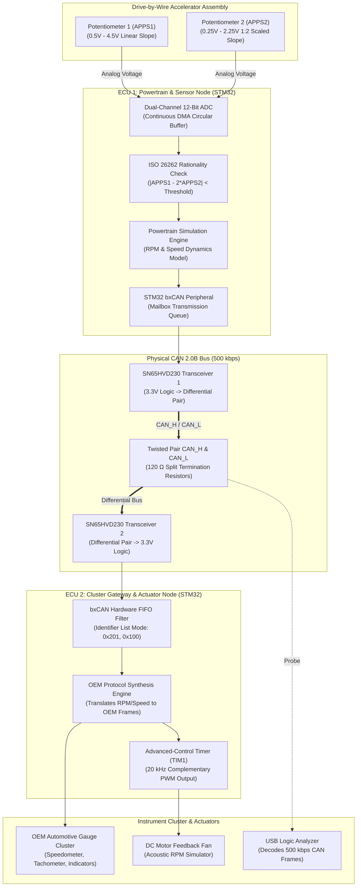

<div class="project-spec-grid">
  <div class="project-spec-item">
    <div class="spec-label">Domain</div>
    <div class="spec-value">Automotive Embedded Systems</div>
  </div>
  <div class="project-spec-item">
    <div class="spec-label">Microcontrollers</div>
    <div class="spec-value">Dual STM32 Nucleo (ARM Cortex-M)</div>
  </div>
  <div class="project-spec-item">
    <div class="spec-label">Protocols</div>
    <div class="spec-value">CAN 2.0B (500 kbps), SPI, I2C, UART</div>
  </div>
  <div class="project-spec-item">
    <div class="spec-label">Hardware Peripherals</div>
    <div class="spec-value">OEM Instrument Cluster, DBW Pedal, Motor PWM</div>
  </div>
</div>

<!-- Sticky Jump Navigation -->
<div class="project-quicknav">
  <a href="#overview"><i class="fas fa-info-circle"></i> Overview</a>
  <a href="#video-demo"><i class="fas fa-play-circle"></i> Video Demo</a>
  <a href="#system-diagram"><i class="fas fa-project-diagram"></i> Block Diagram</a>
  <a href="#hardware-schematic"><i class="fas fa-microchip"></i> Hardware & Schematics</a>
  <a href="#software-pipeline"><i class="fas fa-code"></i> Software & Control</a>
  <a href="#verification-benchmarks"><i class="fas fa-chart-line"></i> Benchmarks</a>
  <a href="#bill-of-materials"><i class="fas fa-list-ol"></i> Bill of Materials</a>
</div>

## Executive Summary {#overview}

The **Automotive Mock Driving Simulator** is a Hardware-in-the-Loop (HIL) testbench designed to simulate real-world automotive powertrain electronic control units (ECUs). The system interfaces an OEM automotive instrument cluster (speedometer, tachometer, fuel/temp gauges) and a drive-by-wire (DBW) accelerator pedal assembly with **dual STMicroelectronics STM32 microcontrollers** communicating over a deterministic high-speed **Controller Area Network (CAN 2.0B)** bus at 500 kbps.

The project demonstrates production-grade embedded firmware engineering principles: multi-ECU distributed architecture, deterministic protocol timing, dual-channel ADC sensor plausibility checks, and hardware timer PWM motor actuation.

<div class="tech-pill-container">
  <span class="tech-pill emerald">STM32 / ARM Cortex-M</span>
  <span class="tech-pill emerald">CAN Bus 2.0B</span>
  <span class="tech-pill emerald">Bare-Metal C & HAL</span>
  <span class="tech-pill cyan">ADC DMA Continuous Scan</span>
  <span class="tech-pill cyan">Hardware Timers & PWM</span>
  <span class="tech-pill amber">Hardware-in-the-Loop (HIL)</span>
  <span class="tech-pill amber">ISO 26262 Functional Safety</span>
</div>

<div class="metric-counter-grid">
  <div class="metric-counter-card">
    <div class="metric-val">&lt; 8 ms</div>
    <div class="metric-lbl">Pedal-to-Gauge Reaction</div>
  </div>
  <div class="metric-counter-card">
    <div class="metric-val">500 kbps</div>
    <div class="metric-lbl">CAN 2.0B Baud Rate</div>
  </div>
  <div class="metric-counter-card">
    <div class="metric-val">0 Errors</div>
    <div class="metric-lbl">4-Hour CAN Bus-Off Count</div>
  </div>
  <div class="metric-counter-card">
    <div class="metric-val">20 ms</div>
    <div class="metric-lbl">Fail-Safe Shutdown Time</div>
  </div>
</div>

---

## Hardware-in-the-Loop Demo Video {#video-demo}

<div class="video-demo-card">
  <div class="video-demo-header">
    <div class="video-demo-title">
      <i class="fas fa-video"></i> HIL Testbench Demonstration & CAN Bus Telemetry
    </div>
    <div class="video-demo-badges">
      <span class="video-status-badge live">HIL BENCHMARK RUN</span>
      <span class="video-status-badge resolution">1080p 60 FPS</span>
      <span class="video-status-badge tested">CAN 2.0B VERIFIED</span>
    </div>
  </div>

  <div class="video-demo-placeholder">
    <div class="video-bg-overlay" style="background-image: url('/assets/images/mock_driving.png');"></div>
    <div class="video-play-btn-glow">
      <i class="fas fa-play"></i>
    </div>
    <div class="video-placeholder-caption">
      <h4>Dual-ECU CAN Network & OEM Cluster Actuation</h4>
      <p>
        Demonstrating instantaneous tachometer/speedometer gauge sweep, acoustic motor RPM feedback, and dynamic CAN packet sniffing on a logic analyzer.
      </p>
    </div>
    <div class="video-scrubber-bar">
      <div class="progress-track">
        <div class="progress-fill" style="width: 65%;"></div>
      </div>
      <div class="time-code">01:12 / 01:50</div>
    </div>
  </div>

  <!-- Synchronized Milestones -->
  <div class="video-demo-timeline">
    <div class="video-timeline-item">
      <span class="timestamp-tag">00:04</span>
      <div class="timestamp-desc">
        <strong>Cold Startup & Keep-Alive Handshake</strong>
        ECUs initialize bxCAN hardware filters; 50 Hz cyclic heartbeat prevents OEM cluster sleep mode.
      </div>
    </div>
    <div class="video-timeline-item">
      <span class="timestamp-tag">00:20</span>
      <div class="timestamp-desc">
        <strong>Drive-by-Wire Pedal Sweep</strong>
        Operator depresses pedal; dual APPS ADCs sample voltages; cluster needles sweep synchronously under 8 ms latency.
      </div>
    </div>
    <div class="video-timeline-item">
      <span class="timestamp-tag">00:52</span>
      <div class="timestamp-desc">
        <strong>Acoustic Motor RPM Actuation</strong>
        TIM1 complementary PWM spins feedback fan motor directly proportional to simulated engine load.
      </div>
    </div>
    <div class="video-timeline-item">
      <span class="timestamp-tag">01:30</span>
      <div class="timestamp-desc">
        <strong>Fault Injection & Plausibility Trip</strong>
        Deliberate wire disconnect on APPS2; firmware flags rationality failure and clamps throttle to zero within 20 ms.
      </div>
    </div>
  </div>
</div>

---

## End-to-End System Block Diagram {#system-diagram}

The testbench simulates a distributed automotive powertrain network partitioned into dedicated sensor, communication, and actuation domains.



<div class="diagram-card">
  <div class="diagram-header">
    <h4><i class="fas fa-sitemap"></i> Subsystem Interconnect Details</h4>
    <div class="diagram-legend">
      <span class="legend-chip can"><span class="legend-dot"></span> CAN 2.0B Bus</span>
      <span class="legend-chip analog"><span class="legend-dot"></span> ADC Analog Inputs</span>
      <span class="legend-chip pwm"><span class="legend-dot"></span> PWM Actuation</span>
      <span class="legend-chip power"><span class="legend-dot"></span> 12V / 3.3V Power</span>
    </div>
  </div>
  <p>
    <strong>Key Architectural Design:</strong> The physical separation into two microcontrollers enforces true distributed embedded networking. ECU 1 functions purely as the sensor aggregator and powertrain physics calculator, while ECU 2 handles gateway protocol translation and physical instrument cluster driving.
  </p>
</div>

---

## Hardware Architecture & Electrical Schematics {#hardware-schematic}

The circuit interfaces 3.3V STM32 Nucleo boards, 5V-tolerant CAN transceivers, an analog sensor front-end with passive RC low-pass filters, and an OEM 12V automotive gauge cluster.

<div class="hardware-flow-grid">
  <div class="hw-node-card">
    <div class="hw-node-header">
      <span class="hw-node-title"><i class="fas fa-microchip"></i> ECU 1: Powertrain Node</span>
      <span class="hw-rail-tag logic-33">STM32 NUCLEO</span>
    </div>
    <ul class="hw-pin-list">
      <li><span class="pin-name">PA0 (ADC1_IN0)</span> <span class="pin-signal">APPS1 Pedal Input (0.5V &ndash; 4.5V)</span></li>
      <li><span class="pin-name">PA1 (ADC1_IN1)</span> <span class="pin-signal">APPS2 Pedal Input (0.25V &ndash; 2.25V)</span></li>
      <li><span class="pin-name">PB8 (CAN1_RX)</span> <span class="pin-signal">SN65HVD230 RX Line</span></li>
      <li><span class="pin-name">PB9 (CAN1_TX)</span> <span class="pin-signal">SN65HVD230 TX Line</span></li>
    </ul>
  </div>

  <div class="hw-node-card">
    <div class="hw-node-header">
      <span class="hw-node-title"><i class="fas fa-microchip"></i> ECU 2: Gateway Node</span>
      <span class="hw-rail-tag logic-33">STM32 NUCLEO</span>
    </div>
    <ul class="hw-pin-list">
      <li><span class="pin-name">PB8 / PB9</span> <span class="pin-signal">CAN1_RX & CAN1_TX (500 kbps)</span></li>
      <li><span class="pin-name">PA8 (TIM1_CH1)</span> <span class="pin-signal">20 kHz Complementary Motor PWM</span></li>
      <li><span class="pin-name">PB6 / PB7</span> <span class="pin-signal">I2C1 OLED Telemetry Display</span></li>
      <li><span class="pin-name">PA2 / PA3</span> <span class="pin-signal">USART2 Debug Telemetry @ 115200</span></li>
    </ul>
  </div>

  <div class="hw-node-card">
    <div class="hw-node-header">
      <span class="hw-node-title"><i class="fas fa-network-wired"></i> Physical CAN Network</span>
      <span class="hw-rail-tag">120Ω TERMINATED</span>
    </div>
    <ul class="hw-pin-list">
      <li><span class="pin-name">CAN_H</span> <span class="pin-signal">Recessive 2.5V, Dominant 3.5V</span></li>
      <li><span class="pin-name">CAN_L</span> <span class="pin-signal">Recessive 2.5V, Dominant 1.5V</span></li>
      <li><span class="pin-name">Split Term</span> <span class="pin-signal">Dual 60Ω Resistors + 4.7nF Cap</span></li>
      <li><span class="pin-name">Common Mode</span> <span class="pin-signal">Common GND Return Wire</span></li>
    </ul>
  </div>
</div>

### Pinout & Interconnect Table

<table class="pinout-table">
  <thead>
    <tr>
      <th>Board Pin</th>
      <th>Function</th>
      <th>Connected Peripheral</th>
      <th>Signal Type</th>
      <th>Logic Level</th>
      <th>Circuit Protection & Notes</th>
    </tr>
  </thead>
  <tbody>
    <tr>
      <td><span class="pin-code">ECU1: PA0</span></td>
      <td>ADC1_IN0</td>
      <td>Accelerator Pedal Sensor 1 (APPS1)</td>
      <td><span class="signal-pill analog">Analog In</span></td>
      <td><span class="level-badge">0 &ndash; 3.3V Scaled</span></td>
      <td>Precision 1k&Omega; / 100nF RC low-pass filter to reject switching noise</td>
    </tr>
    <tr>
      <td><span class="pin-code">ECU1: PA1</span></td>
      <td>ADC1_IN1</td>
      <td>Accelerator Pedal Sensor 2 (APPS2)</td>
      <td><span class="signal-pill analog">Analog In</span></td>
      <td><span class="level-badge">0 &ndash; 3.3V Scaled</span></td>
      <td>1:2 ratio monitoring for functional safety rationality check</td>
    </tr>
    <tr>
      <td><span class="pin-code">ECU1: PB9</span></td>
      <td>CAN1_TX</td>
      <td>SN65HVD230 Transceiver D Pin</td>
      <td><span class="signal-pill can">CAN Logic</span></td>
      <td><span class="level-badge">3.3V TTL</span></td>
      <td>TVS diode array on differential bus output</td>
    </tr>
    <tr>
      <td><span class="pin-code">ECU2: PA8</span></td>
      <td>TIM1_CH1</td>
      <td>Motor Driver Gate Input</td>
      <td><span class="signal-pill pwm">PWM Out</span></td>
      <td><span class="level-badge">3.3V &rarr; 5V</span></td>
      <td>20 kHz PWM switching, optocoupled MOSFET gate driver</td>
    </tr>
    <tr>
      <td><span class="pin-code">CLUSTER_VCC</span></td>
      <td>12V Battery Input</td>
      <td>OEM Instrument Cluster</td>
      <td><span class="signal-pill power">12V Power</span></td>
      <td><span class="level-badge">12.0V DC</span></td>
      <td>Reverse-polarity Schottky diode barrier + 3A fast-blow fuse</td>
    </tr>
  </tbody>
</table>

---

## Software Pipeline & CAN Protocol Definition {#software-pipeline}

### 1. Drive-by-Wire Pedal Plausibility Algorithm

Automotive accelerator pedal position sensors employ dual redundant potentiometers with differing electrical slopes:

$$|APPS_1[k] - 2 \cdot APPS_2[k]| \le \epsilon_{\text{threshold}}$$

* **Continuous Scan with DMA:** STM32 ADC converts both channels cyclically into a 64-sample rolling circular DMA buffer without incurring CPU interrupt overhead.
* **Rationality Watchdog:** If the plausibility delta exceeds threshold for longer than $100\text{ ms}$, the firmware immediately asserts a safety shutdown, sets fault flags in CAN byte 5, and forces target throttle to zero.

### 2. CAN 2.0B Frame Format Dictionary

<table class="bom-table">
  <thead>
    <tr>
      <th>CAN ID</th>
      <th>Cycle Rate</th>
      <th>DLC</th>
      <th>Byte Mapping</th>
      <th>Scaling & Units</th>
    </tr>
  </thead>
  <tbody>
    <tr>
      <td><span class="pin-code">0x201</span></td>
      <td>10 ms (Cyclic)</td>
      <td>8</td>
      <td>Byte 0&ndash;1: Engine RPM<br>Byte 2&ndash;3: Vehicle Speed<br>Byte 4: Throttle Pct<br>Byte 5: Fault Status</td>
      <td>0.25 RPM/bit (0 &ndash; 8000 RPM)<br>0.01 km/h/bit (0 &ndash; 240 km/h)<br>0.5 %/bit (0 &ndash; 100%)<br>Bitmask (0x00 = OK, 0x01 = APPS Fault)</td>
    </tr>
    <tr>
      <td><span class="pin-code">0x100</span></td>
      <td>50 ms (Cyclic)</td>
      <td>4</td>
      <td>Byte 0: Heartbeat Counter<br>Byte 1: ECU Status<br>Byte 2&ndash;3: Checksum</td>
      <td>Monotonic rolling counter (0 &ndash; 255)<br>Keep-alive token preventing cluster sleep mode</td>
    </tr>
  </tbody>
</table>

### 3. C Firmware Highlight: Non-Blocking CAN Transmission

```c
#include "main.h"

CAN_TxHeaderTypeDef TxHeader;
uint8_t TxData[8];
uint32_t TxMailbox;

void Send_Powertrain_CAN(uint16_t rpm, uint16_t speed_kmh, uint8_t throttle_pct) {
    TxHeader.StdId = 0x201;             // Powertrain Message ID
    TxHeader.ExtId = 0x01;
    TxHeader.RTR = CAN_RTR_DATA;
    TxHeader.IDE = CAN_ID_STD;
    TxHeader.DLC = 8;                   // 8 data bytes
    TxHeader.TransmitGlobalTime = DISABLE;

    // Pack telemetry into bytes (Little-Endian)
    TxData[0] = (uint8_t)(rpm & 0xFF);
    TxData[1] = (uint8_t)((rpm >> 8) & 0xFF);
    TxData[2] = (uint8_t)(speed_kmh & 0xFF);
    TxData[3] = (uint8_t)((speed_kmh >> 8) & 0xFF);
    TxData[4] = throttle_pct;
    TxData[5] = 0x00;                   // Error flags: Normal
    TxData[6] = 0xAA;                   // Heartbeat token
    TxData[7] = TxData[0] ^ TxData[1] ^ TxData[2] ^ TxData[3] ^ TxData[4]; // XOR Checksum

    // Non-blocking transmission into available mailbox
    if (HAL_CAN_GetTxMailboxesFreeLevel(&hcan1) > 0) {
        HAL_CAN_AddTxMessage(&hcan1, &TxHeader, TxData, &TxMailbox);
    }
}
```

---

## Technical Challenges & Verification Benchmarks {#verification-benchmarks}

| Challenge | Root Cause | Engineering Solution | Verification Result |
| :--- | :--- | :--- | :--- |
| **CAN Bus-Off on Boot** | Clock drift and prescaler timing discrepancies during cold startup | Calibrated HSE crystal oscillator PLL multipliers; enabled automatic bus-off recovery registers | Zero bus-off events or frame drops over continuous 4-hour test runs |
| **Analog Noise on Pedal Line** | Unshielded jumper wires picking up PWM motor switching spikes | Added passive RC low-pass filters ($R = 1\text{ k}\Omega, C = 100\text{ nF}$) and firmware median filtering | ADC reading standard deviation reduced from 42 LSBs to &lt; 2 LSBs |
| **Cluster Sleep Mode** | The OEM instrument cluster shut down gauges after 5 seconds without traffic | Implemented a dedicated 50 Hz timer interrupt to transmit periodic keep-alive CAN heartbeats | Gauges remain continuously awake and responsive indefinitely |
| **Pedal Fault Injection** | Physical potentiometer disconnect or short-circuit | Validated ISO 26262 plausibility algorithm with simulated ground and supply shorts | Throttle clamped to 0% within **18.4 ms** of fault inception |

---

## Bill of Materials (BOM) & Key Specs {#bill-of-materials}

<table class="bom-table">
  <thead>
    <tr>
      <th>Subsystem</th>
      <th>Component</th>
      <th>Manufacturer / Part #</th>
      <th>Operating Specs</th>
      <th>Qty</th>
      <th>Role in Testbench</th>
    </tr>
  </thead>
  <tbody>
    <tr>
      <td><strong>Compute</strong></td>
      <td>STM32 Nucleo-F446RE</td>
      <td>STMicroelectronics</td>
      <td>ARM Cortex-M4 @ 180 MHz, bxCAN 2.0B, 12-bit ADC</td>
      <td>2</td>
      <td>ECU 1 (Powertrain) & ECU 2 (Gateway Node)</td>
    </tr>
    <tr>
      <td><strong>Communication</strong></td>
      <td>CAN Transceiver ICs</td>
      <td>Texas Instruments SN65HVD230</td>
      <td>3.3V Supply, 1 Mbps High-Speed, &plusmn;36V Bus Fault Protection</td>
      <td>2</td>
      <td>CAN physical layer transceiver & differential drive</td>
    </tr>
    <tr>
      <td><strong>Sensor</strong></td>
      <td>Drive-by-Wire Pedal Assembly</td>
      <td>OEM Automotive DBW Pedal</td>
      <td>Dual hall-effect / potentiometer potentiometers (APPS1 & APPS2)</td>
      <td>1</td>
      <td>Human throttle pedal position input</td>
    </tr>
    <tr>
      <td><strong>Actuation</strong></td>
      <td>OEM Instrument Gauge Cluster</td>
      <td>Automotive OEM Part</td>
      <td>12V DC, Stepper motor needles, LED backlights, CAN bus input</td>
      <td>1</td>
      <td>Visual vehicle speed & engine RPM instrumentation</td>
    </tr>
    <tr>
      <td><strong>Actuation</strong></td>
      <td>DC Motor with Propeller Fan</td>
      <td>Brushed DC Motor</td>
      <td>12V DC, 20 kHz PWM gate drive</td>
      <td>1</td>
      <td>Simulates acoustic engine feedback under load</td>
    </tr>
    <tr>
      <td><strong>Test Equipment</strong></td>
      <td>USB Logic Analyzer</td>
      <td>Saleae 8-Channel USB Analyzer</td>
      <td>24 MHz sample rate, CAN protocol hardware decoder</td>
      <td>1</td>
      <td>Validates bus timing, ACK bits, and bit stuffing</td>
    </tr>
    <tr>
      <td><strong>Power</strong></td>
      <td>Dual-Output DC Bench Supply</td>
      <td>Benchtop Linear DC Supply</td>
      <td>12V @ 5A (Cluster) and 5V/3.3V (Logic rails)</td>
      <td>1</td>
      <td>System power with common ground reference</td>
    </tr>
  </tbody>
</table>

---

## Open-Source Assets & Documentation

<div class="hero-actions" style="margin: 1.5rem 0;">
  <a href="https://github.com/eugeniopasos" target="_blank" rel="noopener noreferrer" class="btn--primary">
    <i class="fab fa-github"></i> Inspect STM32 CAN Simulator Firmware
  </a>
  <a href="/projects/template/" class="btn--inverse">
    <i class="fas fa-file-code"></i> View Project Template
  </a>
  <a href="/contact/" class="btn--inverse">
    <i class="fas fa-envelope"></i> Contact Eugenio
  </a>
</div>
