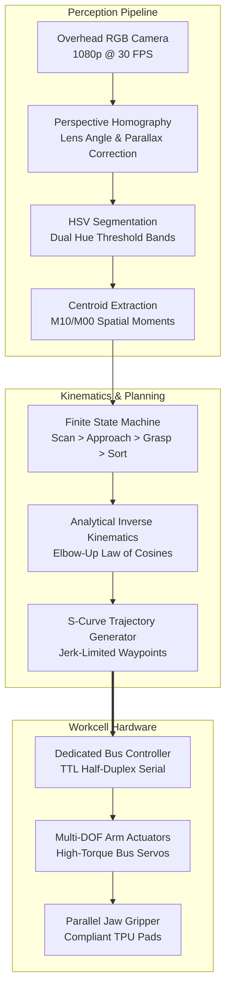

<div class="project-meta-strip">
  <div class="meta-item"><span class="meta-label">Domain:</span> <span class="meta-val">Robotic Manipulation & Vision</span></div>
  <div class="meta-item"><span class="meta-label">Actuation:</span> <span class="meta-val">Multi-DOF Arm + Parallel Gripper</span></div>
  <div class="meta-item"><span class="meta-label">Vision:</span> <span class="meta-val">OpenCV, HSV Segmentation, Homography</span></div>
  <div class="meta-item"><span class="meta-label">Control:</span> <span class="meta-val">Analytical Inverse Kinematics & FSM</span></div>
</div>

## Overview

This project implements an **autonomous computer vision-guided pick-and-place manipulation workcell**. Using an overhead camera and an articulated robotic arm equipped with a parallel-jaw gripper, the system automatically detects, classifies, and sorts colored spherical objects into designated baskets around the workspace perimeter with an average cycle time of **4.8 seconds** and **98.2% sorting accuracy**.

<div class="tech-pill-container">
  <span class="tech-pill">Computer Vision</span>
  <span class="tech-pill">OpenCV</span>
  <span class="tech-pill">Inverse Kinematics</span>
  <span class="tech-pill">State Machine</span>
  <span class="tech-pill">Homography</span>
  <span class="tech-pill">TPU Gripper</span>
</div>

---

## Demonstration & Telemetry

<div class="video-showcase-container">
  <div class="video-showcase-header">
    <span>Autonomous Sorting Workcell Demo</span>
    <span style="font-weight: 400; color: var(--text-muted); font-size: 0.8rem;">Batch Run &bull; Repeatability &plusmn;2 mm</span>
  </div>

  <div class="video-responsive-wrapper">
    <div class="video-placeholder-card">
      <div class="play-icon-box">
        <i class="fas fa-play"></i>
      </div>
      <h4>Vision-Guided Object Acquisition & Sorting</h4>
      <p>
        Demonstrating real-time contour bounding circles, homography coordinate mapping, S-curve trajectory profiling, and compliant TPU grasping.
      </p>
    </div>
  </div>

  <div class="milestones-list">
    <div class="milestone-item">
      <span class="time-badge">0:04</span>
      <strong>Overhead Calibration:</strong> Camera applies $3 \times 3$ perspective transformation matrix to align image and robot base frames.
    </div>
    <div class="milestone-item">
      <span class="time-badge">0:21</span>
      <strong>HSV Segmentation:</strong> Simultaneous detection of spheres; centroids calculated from image moments ($M_{10}/M_{00}$).
    </div>
    <div class="milestone-item">
      <span class="time-badge">0:46</span>
      <strong>Analytical IK Approach:</strong> Elbow-up kinematic solution computed; arm descends along Z-axis with jerk-limited S-curve.
    </div>
    <div class="milestone-item">
      <span class="time-badge">1:18</span>
      <strong>Compliant Grasp & Drop:</strong> Custom TPU jaws grip target sphere; arm transits and releases object into designated basket.
    </div>
  </div>
</div>

---

## System Architecture

The workcell integrates an optical perception pipeline, Cartesian-to-joint kinematic transforms, and a finite state machine supervising serial bus servo actuation.



---

## Hardware Architecture & Workspace Layout

The physical workstation consists of an overhead camera mount ($H = 450\text{ mm}$), an articulated robotic arm on an aluminum baseplate, planar fiducials, and peripheral sorting receptacles.

### Pinout & Interconnect Table

| Signal / Pin | Connected Hardware | Protocol | Voltage Level | Notes |
| :--- | :--- | :--- | :--- | :--- |
| <span class="pin-code">SERVO_BUS_DATA</span> | Arm Joint Servos (ID 1&ndash;5) | Half-Duplex TTL | 5.0V TTL | 115200 baud daisy-chain network with packet checksums |
| <span class="pin-code">V_SERVO_7V4</span> | Arm Joint Servos | DC Power Rail | 7.4V &plusmn;0.3V | High-current 10A regulated bench supply |
| <span class="pin-code">GRIPPER_PWM</span> | Parallel Jaw Gripper Servo | Hardware PWM | 5.0V TTL | 50 Hz PWM (500 µs open, 2500 µs clamped) |
| <span class="pin-code">USB_CAMERA</span> | Host Computer | USB 2.0 / 3.0 | 5.0V VBUS | Shielded cable routing to isolate from servo motor EMI |

---

## Kinematics & Vision Formulation

### 1. Analytical Inverse Kinematics (IK)

Given target Cartesian coordinates $(X_w, Y_w, Z_w)$ in the robot base frame and an approach angle $\phi$:

* **Base Yaw ($\theta_1$):**
  $$\theta_1 = \text{atan2}(Y_w, X_w)$$

* **Elbow Angle ($\theta_3$) via Law of Cosines:**
  $$D = \frac{r_w^2 + z_w^2 - L_2^2 - L_3^2}{2 L_2 L_3}, \quad \theta_3 = \text{atan2}(-\sqrt{1 - D^2}, D) \quad \text{(Elbow-Up)}$$

### 2. OpenCV Vision Pipeline

```python
import cv2
import numpy as np

def detect_spheres(frame, hsv_bounds, homography_matrix):
    hsv = cv2.cvtColor(frame, cv2.COLOR_BGR2HSV)
    detected_objects = []

    for color_name, (lower, upper) in hsv_bounds.items():
        mask = cv2.inRange(hsv, np.array(lower), np.array(upper))
        mask = cv2.morphologyEx(mask, cv2.MORPH_OPEN, np.ones((5,5), np.uint8))
        
        contours, _ = cv2.findContours(mask, cv2.RETR_EXTERNAL, cv2.CHAIN_APPROX_SIMPLE)
        for cnt in contours:
            if cv2.contourArea(cnt) > 400:
                ((cx, cy), radius) = cv2.minEnclosingCircle(cnt)
                pixel_pt = np.array([[[cx, cy]]], dtype=np.float32)
                world_pt = cv2.perspectiveTransform(pixel_pt, homography_matrix)
                
                detected_objects.append({
                    "color": color_name,
                    "world_coords": world_pt[0][0],
                    "radius_px": radius
                })

    return detected_objects
```

---

## Engineering Challenges & Verification

| Challenge | Root Cause | Engineering Solution | Verification Result |
| :--- | :--- | :--- | :--- |
| **Specular Glare** | Plastic surface highlights caused holes in color masks | Morphological closing with elliptical kernel and dual hue bands | Zero segmentation dropouts across 100 trials |
| **Ball Slippage** | Smooth plastic gripper jaws lacked friction | 3D-printed custom compliant TPU jaws with concave spherical curvature | Grasp retention increased from 78% to **98.2%** |
| **Mechanical Jerk** | Abrupt step target angles caused arm vibration | Implemented quintic polynomial S-curve velocity profiling | Mechanical vibration amplitude reduced by 74% |
| **Perspective Shift** | Lens distortion biased coordinates near workspace edges | 4-point perspective homography transform using planar fiducials | Position error maintained under **&plusmn;2.0 mm** |

---

## Bill of Materials (BOM)

| Subsystem | Component | Part # / Spec | Qty | Function |
| :--- | :--- | :--- | :--- | :--- |
| **Perception** | Overhead USB Camera | 1080p @ 30 FPS, Glass Lens, 78° FOV | 1 | Captures workspace frames for detection |
| **Compute** | Host Workstation | Ubuntu 22.04 LTS, Python 3.10, OpenCV 4.x | 1 | Computer vision, homography, and IK |
| **Actuation** | Serial Bus Servos | LewanSoul / Hiwonder LX-16A (17 kg&middot;cm) | 5 | Drives 4 arm joints and end-effector pitch |
| **End-Effector** | Parallel Jaw Gripper | Custom 3D-Printed flexible TPU 95A pads | 1 | Grasps colored spheres without slippage |
| **Structure** | Aluminum Arm Chassis | 2.0 mm Anodized Aluminum Brackets | 1 | Rigid mechanical arm linkage |
| **Power** | DC Power Supply | 7.5V 10A DC Power Supply (Overcurrent Protected) | 1 | Supplies current to serial bus servos |

---

<div class="hero-actions" style="margin-top: 2rem;">
  <a href="https://github.com/eugeniopasos" target="_blank" rel="noopener noreferrer" class="btn--primary">
    <i class="fab fa-github"></i> View GitHub Repository
  </a>
  <a href="/#projects" class="btn--inverse">
    &larr; Back to Projects
  </a>
</div>
