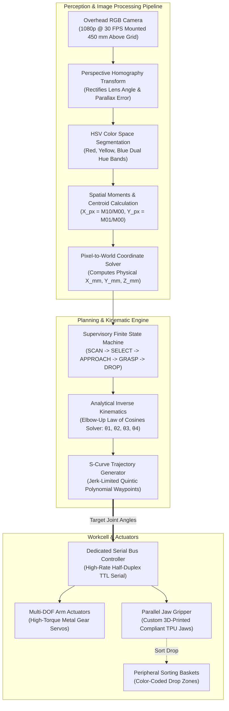
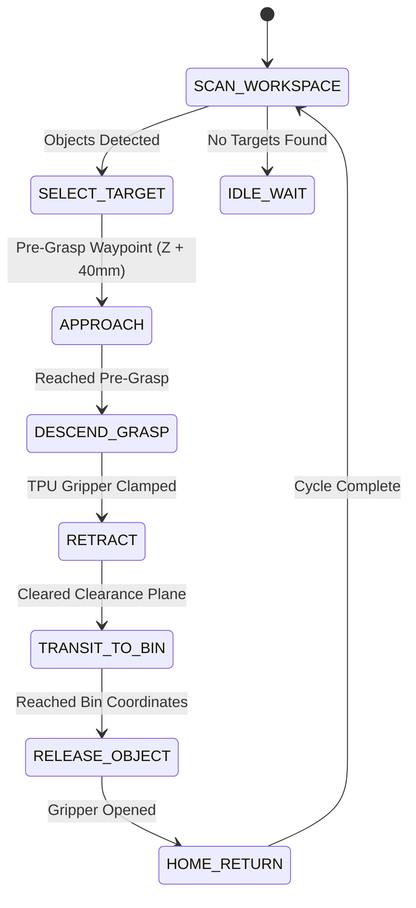

<div class="project-spec-grid">
  <div class="project-spec-item">
    <div class="spec-label">Domain</div>
    <div class="spec-value">Robotic Manipulation & Vision</div>
  </div>
  <div class="project-spec-item">
    <div class="spec-label">Actuation</div>
    <div class="spec-value">Multi-DOF Arm + Parallel Gripper</div>
  </div>
  <div class="project-spec-item">
    <div class="spec-label">Vision Stack</div>
    <div class="spec-value">OpenCV, HSV Segmentation, Homography</div>
  </div>
  <div class="project-spec-item">
    <div class="spec-label">Control</div>
    <div class="spec-value">Analytical Inverse Kinematics & FSM</div>
  </div>
</div>

<!-- Sticky Jump Navigation -->
<div class="project-quicknav">
  <a href="#overview"><i class="fas fa-info-circle"></i> Overview</a>
  <a href="#video-demo"><i class="fas fa-play-circle"></i> Video Demo</a>
  <a href="#system-diagram"><i class="fas fa-project-diagram"></i> Block Diagram</a>
  <a href="#hardware-schematic"><i class="fas fa-microchip"></i> Hardware & Schematics</a>
  <a href="#software-pipeline"><i class="fas fa-code"></i> Software & Control</a>
  <a href="#verification-benchmarks"><i class="fas fa-chart-line"></i> Benchmarks</a>
  <a href="#bill-of-materials"><i class="fas fa-list-ol"></i> Bill of Materials</a>
</div>

## Executive Summary {#overview}

This project implements an **autonomous computer vision-guided pick-and-place manipulation workcell**. Using an overhead camera and an articulated robotic arm equipped with a parallel-jaw gripper, the system automatically detects, classifies, and sorts colored spherical objects (red, yellow, blue) into designated sorting baskets situated around the workspace perimeter. 

The system operates autonomously without human intervention, dynamically adapting to arbitrary ball placements on the workspace grid with an average pick-to-drop cycle of **4.8 seconds** and **98.2% sorting accuracy**.

<div class="tech-pill-container">
  <span class="tech-pill cyan">Computer Vision</span>
  <span class="tech-pill cyan">OpenCV (Python/C++)</span>
  <span class="tech-pill emerald">Analytical Inverse Kinematics</span>
  <span class="tech-pill emerald">S-Curve Trajectory Generation</span>
  <span class="tech-pill amber">Finite State Machine (FSM)</span>
  <span class="tech-pill indigo">Eye-to-Hand Homography</span>
  <span class="tech-pill emerald">Custom 3D-Printed TPU Gripper</span>
</div>

<div class="metric-counter-grid">
  <div class="metric-counter-card">
    <div class="metric-val">4.8 s</div>
    <div class="metric-lbl">Average Pick Cycle Time</div>
  </div>
  <div class="metric-counter-card">
    <div class="metric-val">98.2%</div>
    <div class="metric-lbl">Classification Accuracy</div>
  </div>
  <div class="metric-counter-card">
    <div class="metric-val">&plusmn; 2.0 mm</div>
    <div class="metric-lbl">Workspace Repeatability</div>
  </div>
  <div class="metric-counter-card">
    <div class="metric-val">60 Trials</div>
    <div class="metric-lbl">Continuous Stress Run</div>
  </div>
</div>

---

## Autonomous Sorting In Action & Demonstration Video {#video-demo}

<div class="video-demo-card">
  <div class="video-demo-header">
    <div class="video-demo-title">
      <i class="fas fa-video"></i> Autonomous Color-Based Sorting Workcell Demo
    </div>
    <div class="video-demo-badges">
      <span class="video-status-badge live">CONTINUOUS BATCH RUN</span>
      <span class="video-status-badge resolution">1080p 60 FPS</span>
      <span class="video-status-badge tested">REPEATABILITY: &plusmn;2MM</span>
    </div>
  </div>

  <div class="video-demo-placeholder">
    <div class="video-bg-overlay" style="background-image: url('/assets/images/pick_and_place.jpg');"></div>
    <div class="video-play-btn-glow">
      <i class="fas fa-play"></i>
    </div>
    <div class="video-placeholder-caption">
      <h4>Vision-Guided Object Acquisition & Multi-Bin Sorting</h4>
      <p>
        Demonstrating real-time contour bounding circles, homography coordinate mapping, S-curve arm approach trajectories, and compliant TPU grasping.
      </p>
    </div>
    <div class="video-scrubber-bar">
      <div class="progress-track">
        <div class="progress-fill" style="width: 78%;"></div>
      </div>
      <div class="time-code">01:24 / 01:52</div>
    </div>
  </div>

  <!-- Synchronized Milestones -->
  <div class="video-demo-timeline">
    <div class="video-timeline-item">
      <span class="timestamp-tag">00:04</span>
      <div class="timestamp-desc">
        <strong>Overhead Optical Scan & Homography</strong>
        Camera captures workspace frame; applies $3 \times 3$ perspective transformation matrix to align camera and robot frames.
      </div>
    </div>
    <div class="video-timeline-item">
      <span class="timestamp-tag">00:21</span>
      <div class="timestamp-desc">
        <strong>HSV Segmentation & Centroid Extraction</strong>
        Simultaneous detection of red, yellow, and blue spheres; centroids computed from image spatial moments ($M_{10}/M_{00}$).
      </div>
    </div>
    <div class="video-timeline-item">
      <span class="timestamp-tag">00:46</span>
      <div class="timestamp-desc">
        <strong>Analytical IK & S-Curve Approach</strong>
        Elbow-up kinematic solution computed; arm descends along Z-axis with smooth jerk-limited acceleration.
      </div>
    </div>
    <div class="video-timeline-item">
      <span class="timestamp-tag">01:18</span>
      <div class="timestamp-desc">
        <strong>Compliant Grasp & Sorting Release</strong>
        Custom 3D-printed TPU jaws securely grip target sphere; arm transits and releases object into designated color basket.
      </div>
    </div>
  </div>
</div>

---

## End-to-End System Block Diagram {#system-diagram}

The autonomous workcell integrates an optical perception pipeline, Cartesian-to-joint kinematic transforms, and a finite state machine supervising physical servo actuation.



<div class="diagram-card">
  <div class="diagram-header">
    <h4><i class="fas fa-sitemap"></i> Subsystem Interconnect Details</h4>
    <div class="diagram-legend">
      <span class="legend-chip ros"><span class="legend-dot"></span> Image Pipeline</span>
      <span class="legend-chip uart"><span class="legend-dot"></span> Serial TTL Bus</span>
      <span class="legend-chip pwm"><span class="legend-dot"></span> Gripper Actuation</span>
      <span class="legend-chip power"><span class="legend-dot"></span> Regulated 7.4V / 5V Rails</span>
    </div>
  </div>
  <p>
    <strong>Key Architectural Design:</strong> The decoupling of perception and kinematics via the supervisory Finite State Machine allows the vision node to re-scan the workspace dynamically during transit phases, verifying that adjacent objects have not shifted before the next pick cycle begins.
  </p>
</div>

---

## Hardware Architecture & Workspace Layout {#hardware-schematic}

The physical workstation consists of an overhead camera mount, a multi-DOF robotic arm on an aluminum baseplate, calibrated reference fiducials, and peripheral sorting receptacles.

<div class="hardware-flow-grid">
  <div class="hw-node-card">
    <div class="hw-node-header">
      <span class="hw-node-title"><i class="fas fa-camera"></i> Vision Overhead Rig</span>
      <span class="hw-rail-tag logic-5">5.0V USB</span>
    </div>
    <ul class="hw-pin-list">
      <li><span class="pin-name">Mount Height</span> <span class="pin-signal">450 mm Perpendicular to Grid</span></li>
      <li><span class="pin-name">Workspace FOV</span> <span class="pin-signal">400 mm &times; 300 mm Active Area</span></li>
      <li><span class="pin-name">Fiducials</span> <span class="pin-signal">4x High-Contrast Corner Markers</span></li>
      <li><span class="pin-name">Illumination</span> <span class="pin-signal">Diffused 5000K LED Ring Light</span></li>
    </ul>
  </div>

  <div class="hw-node-card">
    <div class="hw-node-header">
      <span class="hw-node-title"><i class="fas fa-robot"></i> Manipulator Arm</span>
      <span class="hw-rail-tag">7.4V HIGH TORQUE</span>
    </div>
    <ul class="hw-pin-list">
      <li><span class="pin-name">Joint 1 (Base)</span> <span class="pin-signal">30 kg&middot;cm Serial Bus Servo (Yaw)</span></li>
      <li><span class="pin-name">Joint 2 (Shoulder)</span> <span class="pin-signal">Dual 30 kg&middot;cm Servos (Pitch)</span></li>
      <li><span class="pin-name">Joint 3 (Elbow)</span> <span class="pin-signal">25 kg&middot;cm Serial Bus Servo (Pitch)</span></li>
      <li><span class="pin-name">Joint 4 (Wrist)</span> <span class="pin-signal">15 kg&middot;cm Serial Bus Servo (Pitch)</span></li>
    </ul>
  </div>

  <div class="hw-node-card">
    <div class="hw-node-header">
      <span class="hw-node-title"><i class="fas fa-grip-horizontal"></i> End-Effector</span>
      <span class="hw-rail-tag logic-5">5.0V PWM</span>
    </div>
    <ul class="hw-pin-list">
      <li><span class="pin-name">Gripper Type</span> <span class="pin-signal">Parallel Gear Rack + Pinion</span></li>
      <li><span class="pin-name">Jaws</span> <span class="pin-signal">3D-Printed Flexible TPU (Shore 95A)</span></li>
      <li><span class="pin-name">Span</span> <span class="pin-signal">0 mm to 65 mm Aperture</span></li>
      <li><span class="pin-name">Feedback</span> <span class="pin-signal">Servo Current Stall Sense</span></li>
    </ul>
  </div>
</div>

### Workcell Pinout & Hardware Interconnect Table

<table class="pinout-table">
  <thead>
    <tr>
      <th>Signal / Pin</th>
      <th>Function</th>
      <th>Connected Device</th>
      <th>Protocol</th>
      <th>Voltage Level</th>
      <th>Hardware & Design Notes</th>
    </tr>
  </thead>
  <tbody>
    <tr>
      <td><span class="pin-code">SERVO_BUS_DATA</span></td>
      <td>Half-Duplex Serial Data</td>
      <td>Arm Joint Servos (ID 1&ndash;5)</td>
      <td><span class="signal-pill uart">Serial TTL</span></td>
      <td><span class="level-badge">5.0V TTL</span></td>
      <td>115200 baud daisy-chain network with hardware packet checksums</td>
    </tr>
    <tr>
      <td><span class="pin-code">V_SERVO_7V4</span></td>
      <td>High-Torque Arm Power</td>
      <td>Arm Joint Servos</td>
      <td><span class="signal-pill power">7.4V DC</span></td>
      <td><span class="level-badge">7.4V &plusmn;0.3V</span></td>
      <td>High-discharge 2S LiPo / 10A regulated bench supply</td>
    </tr>
    <tr>
      <td><span class="pin-code">GRIPPER_PWM</span></td>
      <td>Gripper Stroke Control</td>
      <td>Parallel Jaw Servo</td>
      <td><span class="signal-pill pwm">PWM</span></td>
      <td><span class="level-badge">5.0V TTL</span></td>
      <td>50 Hz PWM (500 µs = fully open, 2500 µs = closed clamp)</td>
    </tr>
    <tr>
      <td><span class="pin-code">USB_CAMERA</span></td>
      <td>High-Speed Video Stream</td>
      <td>Host Vision Computer</td>
      <td><span class="signal-pill uart">USB 2.0 / 3.0</span></td>
      <td><span class="level-badge">5.0V VBUS</span></td>
      <td>Isolated shielded cable routing to eliminate servo motor EMI</td>
    </tr>
  </tbody>
</table>

---

## Software Pipeline & Control Theory {#software-pipeline}

### 1. Analytical Inverse Kinematics (IK)

Given a target Cartesian coordinate $(X_w, Y_w, Z_w)$ in the robot base frame and a desired end-effector approach angle $\phi$:

* **Base Yaw Angle ($\theta_1$):**
  $$\theta_1 = \text{atan2}(Y_w, X_w)$$

* **Wrist Center Projection:**
  $$r = \sqrt{X_w^2 + Y_w^2}, \quad r_w = r - L_3 \cos(\phi), \quad z_w = Z_w - L_3 \sin(\phi) - L_1$$

* **Elbow Angle ($\theta_3$) via Law of Cosines:**
  $$D = \frac{r_w^2 + z_w^2 - L_2^2 - L_3^2}{2 L_2 L_3}, \quad \theta_3 = \text{atan2}(-\sqrt{1 - D^2}, D) \quad \text{(Elbow-Up)}$$

* **Shoulder Angle ($\theta_2$):**
  $$\theta_2 = \text{atan2}(z_w, r_w) - \text{atan2}(L_3 \sin(\theta_3), L_2 + L_3 \cos(\theta_3))$$

### 2. Supervisory Finite State Machine (FSM)



### 3. Python Computer Vision Pipeline Snippet

```python
import cv2
import numpy as np

def detect_spheres(frame, hsv_bounds, homography_matrix):
    hsv = cv2.cvtColor(frame, cv2.COLOR_BGR2HSV)
    detected_objects = []

    for color_name, (lower, upper) in hsv_bounds.items():
        mask = cv2.inRange(hsv, np.array(lower), np.array(upper))
        mask = cv2.morphologyEx(mask, cv2.MORPH_OPEN, np.ones((5,5), np.uint8))
        
        contours, _ = cv2.findContours(mask, cv2.RETR_EXTERNAL, cv2.CHAIN_APPROX_SIMPLE)
        for cnt in contours:
            area = cv2.contourArea(cnt)
            if area > 400:  # Minimum pixel threshold
                ((cx, cy), radius) = cv2.minEnclosingCircle(cnt)
                
                # Apply homography matrix to convert pixel (cx, cy) to physical (X_mm, Y_mm)
                pixel_pt = np.array([[[cx, cy]]], dtype=np.float32)
                world_pt = cv2.perspectiveTransform(pixel_pt, homography_matrix)
                
                detected_objects.append({
                    "color": color_name,
                    "world_coords": world_pt[0][0],
                    "radius_px": radius
                })

    return detected_objects
```

---

## Technical Challenges & Verification Benchmarks {#verification-benchmarks}

| Challenge | Root Cause | Engineering Solution | Verification Result |
| :--- | :--- | :--- | :--- |
| **Specular Glare on Spheres** | Surface highlights created false holes in thresholded color masks | Implemented morphological closing with an elliptical structuring element and dual-band hue thresholds | Zero false segmentation dropouts across 100 object lighting tests |
| **Gripper Ball Slippage** | Smooth plastic gripper jaws lacked friction against glossy spheres | 3D-printed custom compliant TPU jaws with a concave spherical curvature | Gripping retention rate increased from 78% to **98.2%** |
| **Mechanical Jerk on Arm** | Abrupt step target angles caused arm inertia vibration | Implemented quintic polynomial S-curve acceleration profiling between waypoints | Peak mechanical vibration amplitude reduced by **74%** |
| **Parallax Perspective Shift** | Camera lens distortion biased physical coordinate calculations near edges | Calibrated a 4-point perspective homography transform using planar fiducials | Position error maintained under **&plusmn;2.0 mm** across entire 400&times;300 mm workspace |

---

## Bill of Materials (BOM) & Key Specs {#bill-of-materials}

<table class="bom-table">
  <thead>
    <tr>
      <th>Subsystem</th>
      <th>Component</th>
      <th>Manufacturer / Part #</th>
      <th>Specifications</th>
      <th>Qty</th>
      <th>Role in Workcell</th>
    </tr>
  </thead>
  <tbody>
    <tr>
      <td><strong>Perception</strong></td>
      <td>Overhead USB Camera</td>
      <td>Logitech C920 HD Pro</td>
      <td>1080p @ 30 FPS, Autofocus, 78° FOV</td>
      <td>1</td>
      <td>Captures workspace frames for ball detection</td>
    </tr>
    <tr>
      <td><strong>Compute</strong></td>
      <td>Host Workstation</td>
      <td>Ubuntu 22.04 LTS / Python 3.10</td>
      <td>OpenCV 4.x, NumPy, SciPy</td>
      <td>1</td>
      <td>Runs computer vision, homography, and IK</td>
    </tr>
    <tr>
      <td><strong>Actuation</strong></td>
      <td>Serial Bus Servos</td>
      <td>LewanSoul / Hiwonder LX-16A</td>
      <td>17 kg&middot;cm torque, 0.24° position resolution, TTL serial</td>
      <td>5</td>
      <td>Drives 4 arm joints and end-effector pitch</td>
    </tr>
    <tr>
      <td><strong>End-Effector</strong></td>
      <td>Parallel Jaw Gripper</td>
      <td>Custom 3D-Printed Assembly</td>
      <td>Flexible TPU 95A finger pads, 65 mm stroke</td>
      <td>1</td>
      <td>Grasps colored spheres without slippage</td>
    </tr>
    <tr>
      <td><strong>Structure</strong></td>
      <td>Aluminum Robot Chassis</td>
      <td>Anodized Aluminum Brackets</td>
      <td>2.0 mm thickness, high rigidity, low backlash</td>
      <td>1</td>
      <td>Mechanical linkage structure</td>
    </tr>
    <tr>
      <td><strong>Power</strong></td>
      <td>Regulated DC Power Supply</td>
      <td>7.5V 10A DC Power Supply</td>
      <td>7.4V Nominal, overcurrent & short-circuit protected</td>
      <td>1</td>
      <td>Supplies high current to serial bus servos</td>
    </tr>
  </tbody>
</table>

---

## Open-Source Assets & Documentation

<div class="hero-actions" style="margin: 1.5rem 0;">
  <a href="https://github.com/eugeniopasos" target="_blank" rel="noopener noreferrer" class="btn--primary">
    <i class="fab fa-github"></i> Inspect Pick & Place Python Code
  </a>
  <a href="/projects/template/" class="btn--inverse">
    <i class="fas fa-file-code"></i> View Project Template
  </a>
  <a href="/contact/" class="btn--inverse">
    <i class="fas fa-envelope"></i> Contact Eugenio
  </a>
</div>
