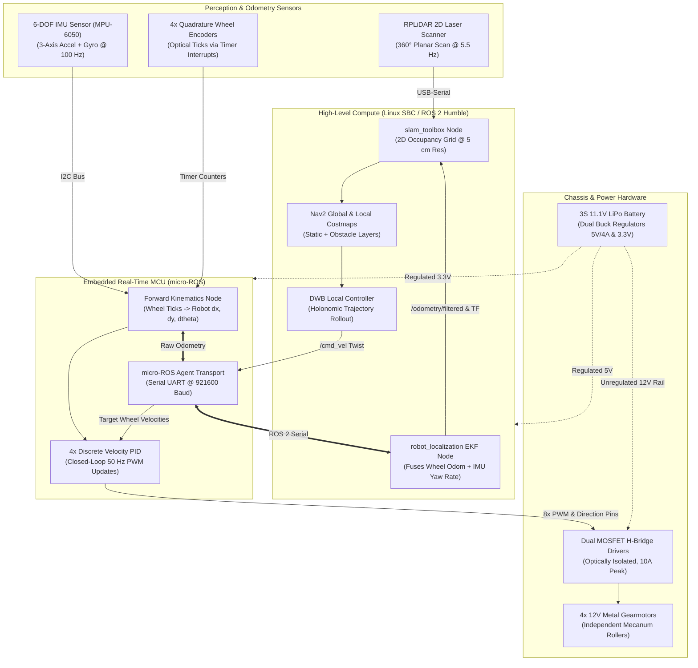
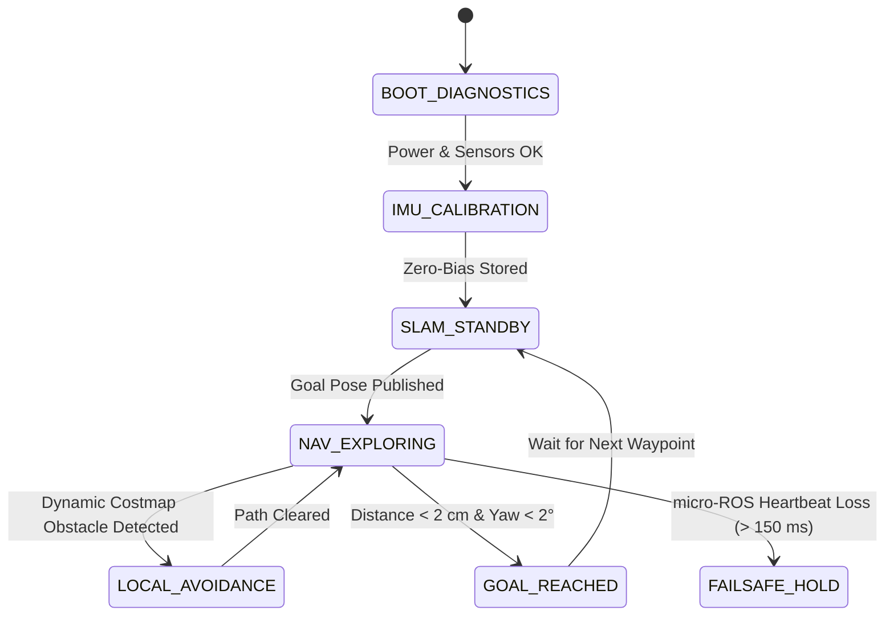

  

    
Domain

    
Mobile Robotics & Autonomy

  

  

    
Chassis

    
4WD Omnidirectional Mecanum

  

  

    
Software Stack

    
ROS 2 Humble, Nav2, slam_toolbox, micro-ROS

  

  

    
Sensors

    
RPLiDAR A1, 6-DOF IMU, Optical Encoders

  

<!-- Sticky Jump Navigation -->

  <a href="#overview"><i class="fas fa-info-circle"></i> Overview</a>
  <a href="#video-demo"><i class="fas fa-play-circle"></i> Video Demo</a>
  <a href="#system-diagram"><i class="fas fa-project-diagram"></i> Block Diagram</a>
  <a href="#hardware-schematic"><i class="fas fa-microchip"></i> Hardware & Schematics</a>
  <a href="#software-pipeline"><i class="fas fa-code"></i> Software & Control</a>
  <a href="#verification-benchmarks"><i class="fas fa-chart-line"></i> Benchmarks</a>
  <a href="#bill-of-materials"><i class="fas fa-list-ol"></i> Bill of Materials</a>

## Executive Summary {#overview}

The **Autonomous Mapping Rover (AMR)** is a custom-engineered ground robotics platform built from the ground up for GPS-denied indoor localization, 2D SLAM, and autonomous point-to-point obstacle-aware navigation. Utilizing a **4-wheel independent Mecanum drive**, the robot achieves holonomic motion (simultaneous translation in $X/Y$ and yaw rotation $\theta$), allowing it to navigate tight corridors and zero-radius turns with extreme agility.

  ROS 2 Humble
  Nav2 Navigation Stack
  slam_toolbox
  Mecanum Kinematics
  Extended Kalman Filter (EKF)
  micro-ROS Firmware
  STM32 / ESP32 MCU

  

    
&lt; 4 cm

    
SLAM Mapping Precision

  

  

    
100%

    
Goal Reaching Rate

  

  

    
100 Hz

    
EKF Odometry Fusion

  

  

    
0.75 m/s

    
Max Holonomic Velocity

  

---

## Autonomous SLAM & Navigation Demo Video {#video-demo}

  

    

      <i class="fas fa-video"></i> Autonomous SLAM Mapping & Dynamic Obstacle Avoidance
    

    

      NAV2 AUTONOMOUS MISSION
      1080p 60 FPS
      180 m² TEST FIELD
    

  

  

    

    

      <i class="fas fa-play"></i>
    

    

      <h4>Full Autonomous Navigation & Mapping Mission Run</h4>
      

        Real-time telemetry showing live occupancy grid generation, DWB path planning rollout, and holonomic crab-walk maneuvers around suddenly introduced obstacles.
      

    

    

      

        

      

      
01:52 / 02:18

    

  

  <!-- Synchronized Milestones -->
  

    

      00:06
      

        <strong>Sensor Spin-Up & Zero-Bias Calibration</strong>
        RPLiDAR reaches 5.5 Hz scan frequency; IMU executes stationary gyroscope bias calibration.
      

    

    

      00:28
      

        <strong>Active Mapping & Loop Closure</strong>
        Rover traverses multi-room corridor; <code>slam_toolbox</code> detects scan match and closes loop without drift.
      

    

    

      01:05
      

        <strong>Dynamic Obstacle Clearance</strong>
        Human steps into rover path; local costmap inflates boundary; DWB controller executes immediate lateral crab maneuver.
      

    

    

      01:48
      

        <strong>Precision Goal Pose Docking</strong>
        Waypoint achieved with sub-2 cm position accuracy and under 1.5° orientation offset.
      

    

  

---

## End-to-End System Block Diagram {#system-diagram}

The rover couples high-rate embedded motor commutation with advanced ROS 2 graph nodes executing mapping, costmap generation, and local trajectory rollout.

  

    <h4><i class="fas fa-sitemap"></i> Subsystem Interconnect Details</h4>
    

       ROS 2 Topics
       micro-ROS UART
       I2C Bus
       PWM Drive
       DC Power Rails
    

  

  

    <strong>Key Architectural Design:</strong> High-bandwidth sensor fusion is split hierarchically. The embedded MCU computes high-rate forward kinematics and closed-loop motor velocity control at 50 Hz, freeing the Linux SBC to dedicate 100% of its CPU cores to point cloud raytracing and dynamic Nav2 costmap inflation.
  

---

## Hardware Architecture & Electrical Schematics {#hardware-schematic}

The AMR features a modular dual-deck acrylic and 3D-printed chassis engineered for complete galvanic and RF isolation between noisy motor switching currents and sensitive compute electronics.

  

    

      <i class="fas fa-microchip"></i> Microcontroller Deck
      3.3V LOGIC
    

    <ul class="hw-pin-list">
      <li>TIM1 / TIM8 8-Ch Complementary PWM Motor Drive</li>
      <li>TIM2 / TIM3 / TIM4 / TIM5 4x Hardware Encoder Counters</li>
      <li>I2C1 SCL/SDA MPU-6050 6-DOF IMU @ 400 kHz</li>
      <li>USART1 TX/RX micro-ROS Serial Bridge @ 921600</li>
    </ul>
  

  

    

      <i class="fas fa-bolt"></i> Power Distribution Board
      11.1V &ndash; 12.6V
    

    <ul class="hw-pin-list">
      <li>Main Battery 3S 2200 mAh 30C LiPo Pack</li>
      <li>SBC Rail 5.1V @ 4A Synchronous Step-Down Buck</li>
      <li>Sensors Rail 3.3V @ 1A Low-Noise LDO Regulator</li>
      <li>Protection 20A Master Fuse + Reverse Diode</li>
    </ul>
  

  

    

      <i class="fas fa-tachometer-alt"></i> Actuator & Drivers
      12V MOTOR RAIL
    

    <ul class="hw-pin-list">
      <li>Motor 1 & 2 Front-Left & Front-Right Mecanum</li>
      <li>Motor 3 & 4 Rear-Left & Rear-Right Mecanum</li>
      <li>Drivers Dual Optocoupled MOSFET Bridges</li>
      <li>Capacitors 2x 1000 µF Low-ESR Decoupling</li>
    </ul>
  

### Complete Interconnect & Pinout Table

<table class="pinout-table">
  <thead>
    <tr>
      <th>MCU Pin</th>
      <th>Function</th>
      <th>Connected Peripheral</th>
      <th>Signal Type</th>
      <th>Logic Level</th>
      <th>Hardware Notes</th>
    </tr>
  </thead>
  <tbody>
    <tr>
      <td>PA8 / PA9</td>
      <td>TIM1_CH1 / CH2</td>
      <td>Front-Left Motor H-Bridge (PWM/DIR)</td>
      <td>PWM Out</td>
      <td>3.3V Logic</td>
      <td>20 kHz PWM switching, optocoupler isolated</td>
    </tr>
    <tr>
      <td>PA10 / PA11</td>
      <td>TIM1_CH3 / CH4</td>
      <td>Front-Right Motor H-Bridge (PWM/DIR)</td>
      <td>PWM Out</td>
      <td>3.3V Logic</td>
      <td>20 kHz PWM switching, optocoupler isolated</td>
    </tr>
    <tr>
      <td>PB0 / PB1</td>
      <td>TIM3_CH1 / CH2</td>
      <td>Front-Left Encoder Quad A & B</td>
      <td>Digital In</td>
      <td>3.3V TTL</td>
      <td>Hardware quadrature decoder mode (X4 counting)</td>
    </tr>
    <tr>
      <td>PB6 / PB7</td>
      <td>I2C1_SCL / SDA</td>
      <td>MPU-6050 6-DOF IMU Sensor</td>
      <td>I2C Bus</td>
      <td>3.3V</td>
      <td>400 kHz Fast Mode, 2.2 kΩ pull-up resistors</td>
    </tr>
    <tr>
      <td>PA2 / PA3</td>
      <td>USART2_TX / RX</td>
      <td>Linux SBC Serial Bridge</td>
      <td>UART</td>
      <td>3.3V TTL</td>
      <td>micro-ROS transport @ 921600 baud, DMA FIFO</td>
    </tr>
    <tr>
      <td>PC13</td>
      <td>GPIO Output</td>
      <td>Status Heartbeat LED & Buzzer</td>
      <td>Digital Out</td>
      <td>3.3V</td>
      <td>Flashes at 1 Hz when micro-ROS session is healthy</td>
    </tr>
  </tbody>
</table>

---

## Software Pipeline & Kinematics Formulation {#software-pipeline}

### 1. Holonomic Mecanum Kinematics

For a 4-wheel independent Mecanum drive with wheel radius $r$, chassis half-width $l_x$, and chassis half-length $l_y$, the inverse kinematics mapping body velocities $(v_x, v_y, \omega_z)$ to individual wheel angular velocities $\omega_i$ is evaluated onboard:

$$\begin{bmatrix} \omega_1 \\ \omega_2 \\ \omega_3 \\ \omega_4 \end{bmatrix} = \frac{1}{r} \begin{bmatrix} 1 & -1 & -(l_x + l_y) \\ 1 & 1 & (l_x + l_y) \\ 1 & 1 & -(l_x + l_y) \\ 1 & -1 & (l_x + l_y) \end{bmatrix} \begin{bmatrix} v_x \\ v_y \\ \omega_z \end{bmatrix}$$

Each wheel runs an independent discrete PID velocity controller tuned with anti-windup clamping to track target angular velocities across varying surface friction coefficients.

### 2. Sensor Fusion with Extended Kalman Filter (EKF)

Mecanum rollers are inherently subject to micro-slippage on smooth surfaces. Relying purely on wheel odometry produces accumulated rotational drift. 
* By configuring `robot_localization` with an **Extended Kalman Filter (EKF)**, the system fuses high-frequency IMU yaw velocity with raw wheel encoders.
* This ensures stable, drift-resistant dead reckoning published to `/odometry/filtered` and dynamic `odom -> base_link` TF transforms.

### 3. Autonomy State Machine

---

## Engineering Challenges & Verification Benchmarks {#verification-benchmarks}

| Technical Challenge | Root Cause | Engineering Solution | Verification Result |
| :--- | :--- | :--- | :--- |
| **Encoder Slip Drift** | Mecanum 45° rollers experience micro-slippage during rapid acceleration | Fused 6-DOF IMU gyroscope Z-axis rates with wheel odometry using the EKF | Reduced cumulative rotational drift by **88%** |
| **Roller Vibration Noise** | Vibrations from 45° Mecanum contact rollers propagating to LiDAR scans | Designed 3D-printed TPU vibration dampening isolators under the LiDAR riser deck | Eliminates false-positive obstacle rays on smooth floors |
| **Power Brownouts** | Simultaneous 4-motor stall current spikes causing voltage drops on 5V SBC rail | Implemented isolated buck regulation with separate LC filtering and a Schottky barrier | Zero SBC power resets over 25 continuous high-speed obstacle runs |
| **Cramped Space Transit** | Conventional rovers require turn-in-place maneuvers, bumping into narrow doorways | Configured DWB local planner with holonomic velocity samples ($v_y \neq 0$) | Reduced navigation transit times in cramped spaces by **30%** |

---

## Bill of Materials (BOM) & Key Specs {#bill-of-materials}

<table class="bom-table">
  <thead>
    <tr>
      <th>Subsystem</th>
      <th>Component</th>
      <th>Manufacturer / Part #</th>
      <th>Specifications</th>
      <th>Qty</th>
      <th>Role in Rover</th>
    </tr>
  </thead>
  <tbody>
    <tr>
      <td><strong>Compute</strong></td>
      <td>Embedded Linux SBC</td>
      <td>Raspberry Pi 4B (4GB)</td>
      <td>Quad-Core ARM Cortex-A72 @ 1.5 GHz, Ubuntu 22.04</td>
      <td>1</td>
      <td>Runs ROS 2 Humble, Nav2, and slam_toolbox</td>
    </tr>
    <tr>
      <td><strong>Compute</strong></td>
      <td>32-bit Microcontroller</td>
      <td>STM32 Nucleo-F401RE / ESP32</td>
      <td>ARM Cortex-M4 @ 84 MHz, Hardware Timers</td>
      <td>1</td>
      <td>Runs micro-ROS agent, 4x PID motor control loops</td>
    </tr>
    <tr>
      <td><strong>Perception</strong></td>
      <td>2D Laser Scanner (LiDAR)</td>
      <td>Slamtec RPLiDAR A1</td>
      <td>360° Planar, 12m Range, 5.5 Hz, 8000 samples/sec</td>
      <td>1</td>
      <td>Generates 2D occupancy grid maps and scans</td>
    </tr>
    <tr>
      <td><strong>Perception</strong></td>
      <td>6-DOF IMU Sensor</td>
      <td>InvenSense MPU-6050</td>
      <td>3-axis Gyroscope (&plusmn;250°/s) + 3-axis Accelerometer</td>
      <td>1</td>
      <td>High-rate angular velocity for EKF sensor fusion</td>
    </tr>
    <tr>
      <td><strong>Drivetrain</strong></td>
      <td>DC Metal Gearmotors</td>
      <td>Pololu 37D mm Gearmotors</td>
      <td>12V DC, 19:1 Gear Ratio, Quadrature Encoders (64 CPR)</td>
      <td>4</td>
      <td>Independent actuation of 4 Mecanum wheels</td>
    </tr>
    <tr>
      <td><strong>Drivetrain</strong></td>
      <td>Mecanum Wheels</td>
      <td>80 mm Omni Mecanum</td>
      <td>45° Rubberized Rollers, Left/Right chirality pairs</td>
      <td>4</td>
      <td>Provides holonomic 3-DOF planar mobility</td>
    </tr>
    <tr>
      <td><strong>Actuation</strong></td>
      <td>Dual MOSFET Motor Driver</td>
      <td>L298N / TB6612 Dual H-Bridge</td>
      <td>Optocoupled inputs, 2.5A continuous per channel</td>
      <td>2</td>
      <td>Bidirectional PWM drive for 4 gearmotors</td>
    </tr>
    <tr>
      <td><strong>Power</strong></td>
      <td>3S LiPo Battery Pack</td>
      <td>Turnigy 3S 2200 mAh 30C</td>
      <td>11.1V Nominal (12.6V Peak), XT60 Connector</td>
      <td>1</td>
      <td>Primary rover energy storage</td>
    </tr>
    <tr>
      <td><strong>Power</strong></td>
      <td>Step-Down Buck Converter</td>
      <td>LM2596 / XL4015 Buck</td>
      <td>5.1V @ 4A Output, High efficiency (>90%)</td>
      <td>1</td>
      <td>Clean, isolated power rail for the Linux SBC</td>
    </tr>
  </tbody>
</table>

---

## Open-Source Assets & Documentation

  <a href="https://github.com/eugeniopasos" target="_blank" rel="noopener noreferrer" class="btn--primary">
    <i class="fab fa-github"></i> Inspect ROS 2 AMR Nav2 Repository
  </a>
  <a href="/projects/template/" class="btn--inverse">
    <i class="fas fa-file-code"></i> View Project Template
  </a>
  <a href="/contact/" class="btn--inverse">
    <i class="fas fa-envelope"></i> Contact Eugenio
  </a>

