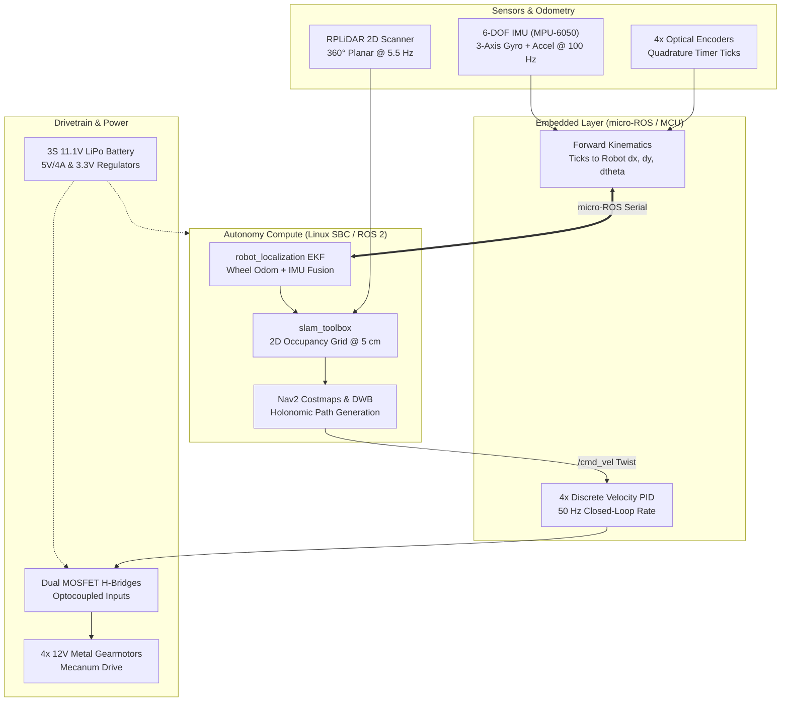

  
Domain: Mobile Robotics & Autonomy

  
Drivetrain: 4WD Omnidirectional Mecanum

  
Stack: ROS 2 Humble, Nav2, slam_toolbox, micro-ROS

  
Sensors: RPLiDAR A1, 6-DOF IMU, Optical Encoders

## Overview

The **Autonomous Mapping Rover (AMR)** is a ground robotics platform engineered for GPS-denied indoor localization, 2D SLAM, and point-to-point obstacle-aware navigation. Utilizing a **4-wheel independent Mecanum drive**, the robot achieves holonomic motion (simultaneous translation in $X/Y$ and yaw rotation $\theta$), allowing it to navigate tight corridors and zero-radius turns with high agility.

  ROS 2 Humble
  Nav2 Stack
  slam_toolbox
  micro-ROS
  EKF Fusion
  Mecanum Kinematics

---

## Demonstration & Telemetry

  

    Autonomous SLAM & Dynamic Navigation
    Field Run &bull; 180 m² Test Environment
  

  

    

      

        <i class="fas fa-play"></i>
      

      <h4>Autonomous Navigation & Obstacle Avoidance</h4>
      

        Real-time telemetry showing live 2D occupancy grid generation, DWB local costmap evaluation, and holonomic crab-walk maneuvers around sudden obstacles.
      

    

  

  

    

      0:06
      <strong>Sensor Initialization:</strong> RPLiDAR spins up to 5.5 Hz; stationary IMU gyroscope bias calibrated.
    

    

      0:28
      <strong>Loop Closure:</strong> <code>slam_toolbox</code> registers scan matches across multiple rooms without drift.
    

    

      1:05
      <strong>Dynamic Obstacle Avoidance:</strong> Local costmap detects obstacle; DWB controller executes lateral crab maneuver.
    

    

      1:48
      <strong>Goal Docking:</strong> Waypoint reached within 2 cm position accuracy and under 1.5° yaw offset.
    

  

---

## System Architecture

The autonomy stack separates real-time motor commutation and high-level mapping to avoid CPU starvation during intensive SLAM updates.

---

## Hardware Architecture & Electrical Interface

The chassis utilizes a dual-deck design providing galvanic and physical isolation between high-current inductive motor switching and sensitive compute electronics.

### Interconnect & Pinout

| MCU Pin | Function | Peripheral | Signal Type | Voltage | Notes |
| :--- | :--- | :--- | :--- | :--- | :--- |
| PA8 / PA9 | TIM1_CH1 / CH2 | Front-Left Motor Driver | PWM Out | 3.3V Logic | 20 kHz PWM, optocoupler isolated |
| PA10 / PA11 | TIM1_CH3 / CH4 | Front-Right Motor Driver | PWM Out | 3.3V Logic | 20 kHz PWM, optocoupler isolated |
| PB0 / PB1 | TIM3_CH1 / CH2 | Front-Left Encoder | Digital In | 3.3V TTL | Hardware quadrature decoder mode |
| PB6 / PB7 | I2C1_SCL / SDA | MPU-6050 6-DOF IMU | I2C Bus | 3.3V | 400 kHz Fast Mode, 2.2 kΩ pull-ups |
| PA2 / PA3 | USART2_TX / RX | Linux SBC Bridge | UART | 3.3V TTL | micro-ROS transport @ 921600 baud |

---

## Kinematics & Mathematical Formulation

For a 4-wheel Mecanum drive with wheel radius $r$, chassis half-width $l_x$, and chassis half-length $l_y$, the inverse kinematics mapping chassis velocities $(v_x, v_y, \omega_z)$ to individual wheel velocities $\omega_i$ is evaluated onboard:

$$\begin{bmatrix} \omega_1 \\ \omega_2 \\ \omega_3 \\ \omega_4 \end{bmatrix} = \frac{1}{r} \begin{bmatrix} 1 & -1 & -(l_x + l_y) \\ 1 & 1 & (l_x + l_y) \\ 1 & 1 & -(l_x + l_y) \\ 1 & -1 & (l_x + l_y) \end{bmatrix} \begin{bmatrix} v_x \\ v_y \\ \omega_z \end{bmatrix}$$

Mecanum rollers are subject to slip on smooth surfaces. An **Extended Kalman Filter (EKF)** fuses raw wheel odometry with high-rate IMU angular rate data, reducing cumulative rotational drift by **88%**.

---

## Engineering Challenges & Verification

| Challenge | Root Cause | Engineering Solution | Verification Result |
| :--- | :--- | :--- | :--- |
| **Roller Slip Drift** | 45° Mecanum roller micro-slippage during acceleration | Fused 6-DOF IMU gyro Z-axis rates with wheel odometry using EKF | Rotational drift reduced by 88% |
| **Vibration Noise** | Contact roller vibrations transmitting to LiDAR scan plane | 3D-printed TPU dampening isolators under LiDAR riser deck | Eliminated false-positive obstacle rays |
| **Power Brownouts** | Simultaneous 4-motor stall current dips on 5V SBC rail | Isolated buck regulation with separate LC filtering and Schottky diode | Zero SBC reboots over 25 stress runs |
| **Confined Maneuvers** | Turn-in-place maneuvers bumping into tight spaces | Configured DWB local controller with holonomic lateral samples ($v_y \neq 0$) | 30% faster transit through narrow passages |

---

## Bill of Materials (BOM)

| Subsystem | Component | Part # / Spec | Qty | Function |
| :--- | :--- | :--- | :--- | :--- |
| **Compute** | Linux SBC | Raspberry Pi 4B (4GB), Ubuntu 22.04 LTS | 1 | Runs ROS 2 Humble, Nav2, and slam_toolbox |
| **Compute** | Microcontroller | STM32 Nucleo-F401RE / ESP32 | 1 | Runs micro-ROS agent and 4x PID motor loops |
| **Perception** | 2D LiDAR | Slamtec RPLiDAR A1 (360° Planar, 12m) | 1 | 2D occupancy grid mapping & laser scans |
| **Perception** | 6-DOF IMU | InvenSense MPU-6050 (I2C 400 kHz) | 1 | Angular rate tracking for EKF fusion |
| **Drivetrain** | DC Gearmotors | Pololu 37D mm, 19:1 ratio, 64 CPR encoders | 4 | Independent 4-wheel actuation |
| **Drivetrain** | Mecanum Wheels | 80 mm diameter with 45° rubber rollers | 4 | Holonomic omnidirectional mobility |
| **Power** | 3S LiPo Battery | Turnigy 11.1V 2200 mAh 30C | 1 | Main system energy source |
| **Power** | Buck Regulator | LM2596 / XL4015 (5.1V @ 4A output) | 1 | Clean isolated power for SBC |

---

  <a href="https://github.com/eugeniopasos" target="_blank" rel="noopener noreferrer" class="btn--primary">
    <i class="fab fa-github"></i> View GitHub Repository
  </a>
  <a href="/#projects" class="btn--inverse">
    &larr; Back to Projects
  </a>

