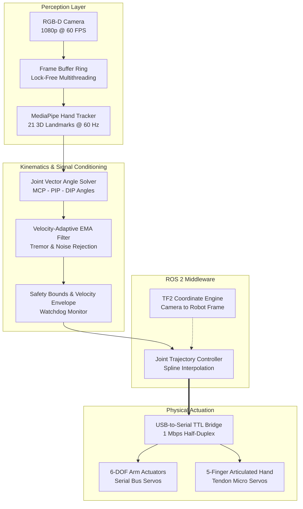

<div class="project-meta-strip">
  <div class="meta-item"><span class="meta-label">Domain:</span> <span class="meta-val">Robotics & Computer Vision</span></div>
  <div class="meta-item"><span class="meta-label">Timeline:</span> <span class="meta-val">2024</span></div>
  <div class="meta-item"><span class="meta-label">Stack:</span> <span class="meta-val">ROS 2 Humble, MediaPipe, OpenCV, C++, Python</span></div>
  <div class="meta-item"><span class="meta-label">Hardware:</span> <span class="meta-val">6-DOF Manipulator, Articulated Hand, RGB-D Camera</span></div>
</div>

## Overview

This project implements a **contactless, 3D vision-based teleoperation platform** enabling an operator to control a multi-DOF robotic arm and dexterous articulated hand in real time. Rather than relying on expensive motion-capture suits or haptic gloves, the pipeline extracts 21 hand landmarks and arm poses from optical feeds, translating human motion into smooth joint trajectories with **under 32 ms end-to-end latency**.

<div class="tech-pill-container">
  <span class="tech-pill">ROS 2 Humble</span>
  <span class="tech-pill">OpenCV</span>
  <span class="tech-pill">MediaPipe</span>
  <span class="tech-pill">Kinematics</span>
  <span class="tech-pill">EMA Filtering</span>
  <span class="tech-pill">RS-485 / TTL Bus</span>
</div>

---

## Demonstration & Telemetry

<div class="video-showcase-container">
  <div class="video-showcase-header">
    <span>Demonstration & Dynamic Tracking</span>
    <span style="font-weight: 400; color: var(--text-muted); font-size: 0.8rem;">Benchmark Run &bull; 60 FPS</span>
  </div>

  <!-- Video Player / Embed: Drop YouTube, Vimeo, or MP4 video here -->
  <div class="video-responsive-wrapper">
    <div class="video-placeholder-card">
      <div class="play-icon-box">
        <i class="fas fa-play"></i>
      </div>
      <h4>Operator Tracking & Compliant Grasp Demonstration</h4>
      <p>
        Demonstrating simultaneous 6-DOF arm positioning and 5-finger articulated tendon actuation synchronized with human hand gestures.
      </p>
    </div>
  </div>

  <div class="milestones-list">
    <div class="milestone-item">
      <span class="time-badge">0:04</span>
      <strong>Hand Calibration:</strong> Extracts 21 skeletal landmarks and establishes wrist coordinate frame.
    </div>
    <div class="milestone-item">
      <span class="time-badge">0:22</span>
      <strong>6-DOF Arm Tracking:</strong> Manipulator tracks operator's Cartesian end-effector coordinates.
    </div>
    <div class="milestone-item">
      <span class="time-badge">0:48</span>
      <strong>Dexterous Grasp:</strong> Joint vector angles resolve individual finger curls for compliant grasp.
    </div>
    <div class="milestone-item">
      <span class="time-badge">1:15</span>
      <strong>Out-of-Frame Failsafe:</strong> Heartbeat watchdog decelerates arm to a safe stop within 30 ms.
    </div>
  </div>
</div>

---

## System Architecture

The pipeline decouples video frame acquisition, inference, signal conditioning, and motor actuation through lock-free ROS 2 communication nodes.



---

## Hardware Architecture & Electrical Interface

The hardware workstation couples the optical perception frontend with high-torque serial bus servos, isolated dual-rail DC power supplies, and star grounding to prevent motor return currents from disturbing logic lines.

### Bus Interconnect & Pinout

| Signal / Pin | Subsystem | Protocol | Voltage Level | Notes |
| :--- | :--- | :--- | :--- | :--- |
| <span class="pin-code">SERVO_DATA</span> | 6x Arm Joint Servos | Half-Duplex TTL | 5.0V TTL | 1.0 Mbps baud, 10k pull-up, TVS diode clamped |
| <span class="pin-code">V_SERVO_12V</span> | Arm Servo Power Bus | DC Power Rail | 12.0V &plusmn;0.2V | 10A peak rating with 2200 µF reservoir capacitor |
| <span class="pin-code">HAND_PWM_1..5</span> | Hand Tendon Servos | Hardware PWM | 5.0V Logic | 50 Hz PWM (1.0 ms &ndash; 2.0 ms pulse width) |
| <span class="pin-code">V_HAND_5V</span> | Hand Motor Power | Regulated DC Rail | 5.0V DC | Isolated buck converter prevents arm switching sag |
| <span class="pin-code">GND_STAR</span> | System Reference | Ground | 0V Reference | Central star ground prevents logic reference shifts |

---

## Signal Processing & Adaptive Filtering

Monocular landmark estimation is susceptible to sub-pixel tracking jitter. Applying a static low-pass filter introduces phase lag during rapid motions, while disabling filtering causes actuator chatter. 

An **adaptive Exponential Moving Average (EMA)** filter adjusts the smoothing factor dynamically based on instantaneous joint velocity:

$$\alpha(v) = \alpha_{\min} + (\alpha_{\max} - \alpha_{\min}) \cdot \text{clamp}\left(\frac{\|v\|}{v_{\text{threshold}}}, 0, 1\right)$$

$$\hat{\theta}[k] = \alpha(v) \cdot \theta_{\text{raw}}[k] + (1 - \alpha(v)) \cdot \hat{\theta}[k-1]$$

```python
import numpy as np

class AdaptiveJointFilter:
    def __init__(self, alpha_min=0.25, alpha_max=0.85, velocity_threshold=1.5):
        self.alpha_min = alpha_min
        self.alpha_max = alpha_max
        self.v_thresh = velocity_threshold
        self.prev_filtered = None
        self.prev_time = None

    def update(self, raw_angles: np.ndarray, current_time: float) -> np.ndarray:
        if self.prev_filtered is None:
            self.prev_filtered = raw_angles.copy()
            self.prev_time = current_time
            return self.prev_filtered

        dt = max(current_time - self.prev_time, 1e-4)
        velocity = np.linalg.norm((raw_angles - self.prev_filtered) / dt)

        # Dynamic alpha: higher when moving fast, lower when static
        t = np.clip(velocity / self.v_thresh, 0.0, 1.0)
        alpha = self.alpha_min + t * (self.alpha_max - self.alpha_min)

        filtered = alpha * raw_angles + (1.0 - alpha) * self.prev_filtered
        self.prev_filtered = filtered
        self.prev_time = current_time
        return filtered
```

---

## Engineering Challenges & Verification

| Challenge | Root Cause | Engineering Solution | Verification Result |
| :--- | :--- | :--- | :--- |
| **High-Frequency Jitter** | Monocular landmark tracking fluctuations | Designed adaptive EMA filter adjusting $\alpha$ with velocity | 82% reduction in actuator RMS vibration |
| **Loop Latency** | Pipeline serialization bottlenecks | Decoupled capture and inference into lock-free worker threads | End-to-end latency reduced to **31.4 ms** |
| **Loss of Tracking** | Operator hand temporarily exiting frame | Heartbeat watchdog node with confidence thresholding (< 0.65) | 100% fail-safe arrest across 40 exit trials |
| **Ground Bounce** | Simultaneous multi-servo acceleration surges | Star ground topology with 2200 µF low-ESR bulk capacitors | Zero serial packet CRC errors over 3-hour run |

---

## Bill of Materials (BOM)

| Subsystem | Component | Part # / Spec | Qty | Function |
| :--- | :--- | :--- | :--- | :--- |
| **Perception** | Optical Camera | 1080p @ 60 FPS, Low-distortion glass lens | 1 | Real-time human hand & gesture tracking |
| **Compute** | Host Workstation | Ubuntu 22.04 LTS, ROS 2 Humble | 1 | MediaPipe inference & trajectory planning |
| **Actuation** | 6-DOF Robotic Arm | High-Torque Serial Bus Servos (25 kg&middot;cm) | 1 | Spatial arm positioning & wrist orientation |
| **End-Effector** | Articulated Hand | 5-Finger Tendon Hand with micro servos | 1 | Finger flexion & compliant grasping |
| **Interface** | USB-to-TTL Bridge | FTDI FT232R (1 Mbps hardware baud) | 1 | Serial bus communication |
| **Power** | DC Power Supply | Mean Well 12V DC @ 12.5A, low ripple | 1 | Actuator bus power rail |
| **Power** | Buck Converter | Texas Instruments LM2596 (12V &rarr; 5V @ 4A) | 1 | Hand tendon servo power |

---

<div class="hero-actions" style="margin-top: 2rem;">
  <a href="https://github.com/eugeniopasos" target="_blank" rel="noopener noreferrer" class="btn--primary">
    <i class="fab fa-github"></i> View GitHub Repository
  </a>
  <a href="/#projects" class="btn--inverse">
    &larr; Back to Projects
  </a>
</div>
