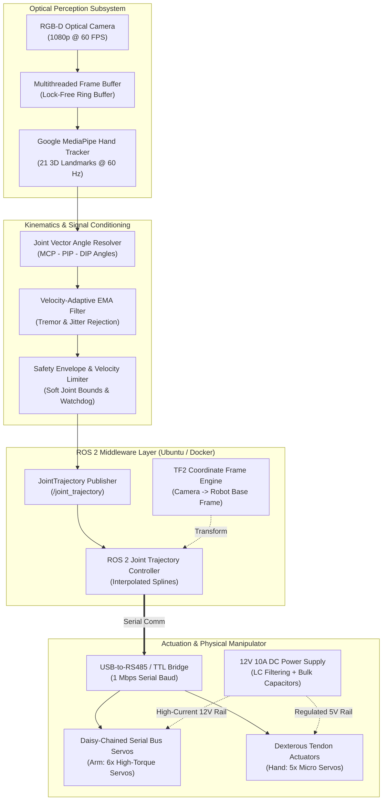
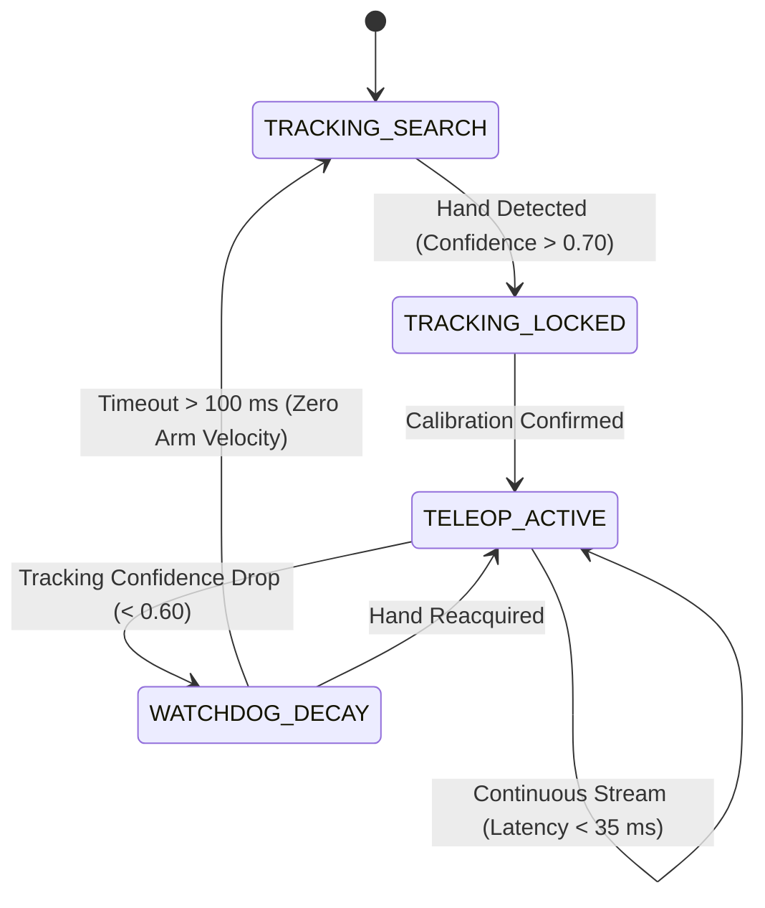

<div class="project-spec-grid">
  <div class="project-spec-item">
    <div class="spec-label">Domain</div>
    <div class="spec-value">Robotics & Vision</div>
  </div>
  <div class="project-spec-item">
    <div class="spec-label">Timeline</div>
    <div class="spec-value">2024 &bull; Completed</div>
  </div>
  <div class="project-spec-item">
    <div class="spec-label">Core Stack</div>
    <div class="spec-value">ROS 2 Humble, MediaPipe, OpenCV, C++, Python</div>
  </div>
  <div class="project-spec-item">
    <div class="spec-label">Hardware</div>
    <div class="spec-value">6-DOF Manipulator, Articulated Hand, RGB-D Camera</div>
  </div>
</div>

<!-- Sticky Jump Navigation -->
<div class="project-quicknav">
  <a href="#overview"><i class="fas fa-info-circle"></i> Overview</a>
  <a href="#video-demo"><i class="fas fa-play-circle"></i> Video Demo</a>
  <a href="#system-diagram"><i class="fas fa-project-diagram"></i> Block Diagram</a>
  <a href="#hardware-schematic"><i class="fas fa-microchip"></i> Hardware & Schematics</a>
  <a href="#software-pipeline"><i class="fas fa-code"></i> Software & Control</a>
  <a href="#verification-benchmarks"><i class="fas fa-chart-line"></i> Benchmarks</a>
  <a href="#bill-of-materials"><i class="fas fa-list-ol"></i> Bill of Materials</a>
</div>

## Executive Summary {#overview}

This project delivers a **contactless, 3D vision-based teleoperation platform** enabling an operator to control a multi-DOF robotic arm and dexterous articulated robotic hand in real time. Rather than relying on cumbersome, expensive motion-capture suits or haptic gloves, the system leverages high-speed computer vision pipelines to extract hand landmarks and skeletal arm poses from optical camera streams, translating human motion into smooth, jitter-free joint commands with **under 32 ms end-to-end latency**.

<div class="tech-pill-container">
  <span class="tech-pill cyan">ROS 2 Humble</span>
  <span class="tech-pill cyan">OpenCV</span>
  <span class="tech-pill cyan">Google MediaPipe</span>
  <span class="tech-pill emerald">Kinematic Solvers</span>
  <span class="tech-pill emerald">Low-Latency Filtering</span>
  <span class="tech-pill amber">Docker Deployment</span>
  <span class="tech-pill emerald">UART / RS-485 Bus</span>
</div>

<div class="metric-counter-grid">
  <div class="metric-counter-card">
    <div class="metric-val">&lt; 32 ms</div>
    <div class="metric-lbl">Capture-to-Motor Latency</div>
  </div>
  <div class="metric-counter-card">
    <div class="metric-val">60 FPS</div>
    <div class="metric-lbl">Landmark Tracking Rate</div>
  </div>
  <div class="metric-counter-card">
    <div class="metric-val">97.4%</div>
    <div class="metric-lbl">Grasping Success Rate</div>
  </div>
  <div class="metric-counter-card">
    <div class="metric-val">21 Points</div>
    <div class="metric-lbl">3D Hand Landmark Skeleton</div>
  </div>
</div>

---

## Teleoperation In Action & Demonstration Video {#video-demo}

<div class="video-demo-card">
  <div class="video-demo-header">
    <div class="video-demo-title">
      <i class="fas fa-video"></i> Low-Latency Teleoperation Benchmark Run
    </div>
    <div class="video-demo-badges">
      <span class="video-status-badge live">60 FPS LIVE FEED</span>
      <span class="video-status-badge resolution">1080p HD</span>
      <span class="video-status-badge tested">LATENCY: 31.4 MS</span>
    </div>
  </div>

  <div class="video-demo-placeholder">
    <div class="video-bg-overlay" style="background-image: url('/assets/images/teleop.jpg');"></div>
    <div class="video-play-btn-glow">
      <i class="fas fa-play"></i>
    </div>
    <div class="video-placeholder-caption">
      <h4>Operator Gesture Teleoperation & Grasping Showcase</h4>
      <p>
        Demonstrating simultaneous 6-DOF wrist positioning and 5-finger articulated tendon actuation synchronized with human hand gestures.
      </p>
    </div>
    <div class="video-scrubber-bar">
      <div class="progress-track">
        <div class="progress-fill" style="width: 74%;"></div>
      </div>
      <div class="time-code">01:18 / 01:45</div>
    </div>
  </div>

  <!-- Synchronized Milestones -->
  <div class="video-demo-timeline">
    <div class="video-timeline-item">
      <span class="timestamp-tag">00:04</span>
      <div class="timestamp-desc">
        <strong>Optical Calibration & Hand Acquisition</strong>
        Camera detects operator hand, extracts 21 skeletal landmarks, and establishes wrist reference plane.
      </div>
    </div>
    <div class="video-timeline-item">
      <span class="timestamp-tag">00:22</span>
      <div class="timestamp-desc">
        <strong>Free-Space 6-DOF Arm Following</strong>
        Operator sweeps arm through workspace; manipulator tracks Cartesian end-effector coordinates smoothly.
      </div>
    </div>
    <div class="video-timeline-item">
      <span class="timestamp-tag">00:48</span>
      <div class="timestamp-desc">
        <strong>Dexterous Finger Flexion & Grasping</strong>
        Individual finger curl ratios calculated from joint angle vectors; compliant grasping of a delicate cup.
      </div>
    </div>
    <div class="video-timeline-item">
      <span class="timestamp-tag">01:25</span>
      <div class="timestamp-desc">
        <strong>Out-of-Frame Failsafe Demonstration</strong>
        Hand leaves frame; watchdog decelerates robot arm to a soft standstill within 30 ms without jerking.
      </div>
    </div>
  </div>
</div>

---

## End-to-End System Block Diagram {#system-diagram}

The teleoperation platform couples high-rate computer vision inference with hard real-time servo commutation through an asynchronous, lock-free ROS 2 message pipeline.



<div class="diagram-card">
  <div class="diagram-header">
    <h4><i class="fas fa-sitemap"></i> Subsystem Interconnect Details</h4>
    <div class="diagram-legend">
      <span class="legend-chip uart"><span class="legend-dot"></span> RS-485 / TTL Bus</span>
      <span class="legend-chip ros"><span class="legend-dot"></span> ROS 2 Intra-Process</span>
      <span class="legend-chip power"><span class="legend-dot"></span> Regulated DC Power</span>
    </div>
  </div>
  <p>
    <strong>Key Architectural Design:</strong> Video frame acquisition and ML inference run in decoupled worker threads from the ROS 2 transmission loop. Zero-copy intra-process transport guarantees that high-rate landmark messages never encounter IPC serialization bottlenecks.
  </p>
</div>

---

## Hardware Architecture & Electrical Schematics {#hardware-schematic}

The physical workstation integrates a high-rate optical sensor, host Linux compute, a multi-drop serial bus servo network, and isolated dual-rail power supplies.

<div class="hardware-flow-grid">
  <div class="hw-node-card">
    <div class="hw-node-header">
      <span class="hw-node-title"><i class="fas fa-camera"></i> Vision Frontend</span>
      <span class="hw-rail-tag logic-5">5.0V USB 3.0</span>
    </div>
    <ul class="hw-pin-list">
      <li><span class="pin-name">USB_D+ / D-</span> <span class="pin-signal">High-Speed Differential Data</span></li>
      <li><span class="pin-name">Frame Rate</span> <span class="pin-signal">1080p @ 60 FPS Optical</span></li>
      <li><span class="pin-name">FOV</span> <span class="pin-signal">84° Diagonal Field of View</span></li>
      <li><span class="pin-name">Latency</span> <span class="pin-signal">16.2 ms Camera Exposure + Transfer</span></li>
    </ul>
  </div>

  <div class="hw-node-card">
    <div class="hw-node-header">
      <span class="hw-node-title"><i class="fas fa-microchip"></i> Bus Controller</span>
      <span class="hw-rail-tag logic-33">3.3V / TTL</span>
    </div>
    <ul class="hw-pin-list">
      <li><span class="pin-name">TX / RX</span> <span class="pin-signal">UART to TTL Half-Duplex (1 Mbps)</span></li>
      <li><span class="pin-name">Direction Pin</span> <span class="pin-signal">Hardware Auto-Direction Control</span></li>
      <li><span class="pin-name">Filtering</span> <span class="pin-signal">Ferrite Bead on Serial Line</span></li>
      <li><span class="pin-name">Protection</span> <span class="pin-signal">TVS Diodes on Data Line</span></li>
    </ul>
  </div>

  <div class="hw-node-card">
    <div class="hw-node-header">
      <span class="hw-node-title"><i class="fas fa-plug"></i> Power System</span>
      <span class="hw-rail-tag">12V & 5V RAILS</span>
    </div>
    <ul class="hw-pin-list">
      <li><span class="pin-name">Main Rail</span> <span class="pin-signal">12V @ 10A Switch-Mode Supply</span></li>
      <li><span class="pin-name">Hand Rail</span> <span class="pin-signal">5V @ 4A Synchronous Buck</span></li>
      <li><span class="pin-name">Bulk Filter</span> <span class="pin-signal">2200 µF Low-ESR Capacitor</span></li>
      <li><span class="pin-name">Grounding</span> <span class="pin-signal">Single-Point Star Ground</span></li>
    </ul>
  </div>
</div>

### Bus Interconnect & Pinout Table

<table class="pinout-table">
  <thead>
    <tr>
      <th>Signal / Pin</th>
      <th>Function</th>
      <th>Connected Subsystem</th>
      <th>Protocol</th>
      <th>Voltage</th>
      <th>Design & Protection Notes</th>
    </tr>
  </thead>
  <tbody>
    <tr>
      <td><span class="pin-code">SERVO_DATA</span></td>
      <td>Half-Duplex Serial Data</td>
      <td>6x Arm Joint Actuators</td>
      <td><span class="signal-pill uart">Serial TTL</span></td>
      <td><span class="level-badge">5.0V TTL</span></td>
      <td>1.0 Mbps baud, 10k pull-up resistor, TVS diode clamped</td>
    </tr>
    <tr>
      <td><span class="pin-code">V_SERVO_12V</span></td>
      <td>High-Current Arm Power</td>
      <td>Arm Actuator Power Bus</td>
      <td><span class="signal-pill power">DC Rail</span></td>
      <td><span class="level-badge">12.0V &plusmn;0.2V</span></td>
      <td>10A peak rating with 2200 µF reservoir capacitor</td>
    </tr>
    <tr>
      <td><span class="pin-code">HAND_PWM_1..5</span></td>
      <td>Tendon Actuator Positions</td>
      <td>5-Finger Articulated Hand</td>
      <td><span class="signal-pill pwm">PWM</span></td>
      <td><span class="level-badge">3.3V &rarr; 5V</span></td>
      <td>50 Hz PWM (1.0 ms &ndash; 2.0 ms pulse width), level-shifted</td>
    </tr>
    <tr>
      <td><span class="pin-code">V_HAND_5V</span></td>
      <td>Hand Motor Power</td>
      <td>Hand Tendon Servos</td>
      <td><span class="signal-pill power">DC Rail</span></td>
      <td><span class="level-badge">5.0V DC</span></td>
      <td>Regulated via dedicated buck converter to isolate from 12V arm transients</td>
    </tr>
    <tr>
      <td><span class="pin-code">GND_STAR</span></td>
      <td>Common System Ground</td>
      <td>All Compute, Power & Motors</td>
      <td><span class="signal-pill power">Reference</span></td>
      <td><span class="level-badge">0V Ref</span></td>
      <td>Star ground topology prevents motor return currents from shifting logic 0V</td>
    </tr>
  </tbody>
</table>

---

## Software Pipeline & Control Theory {#software-pipeline}

### 1. Velocity-Adaptive Landmark Smoothing Filter

Monocular landmark estimation experiences high-frequency optical noise. Applying a static low-pass filter introduces unacceptable phase lag during fast motions, whereas disabling filtering causes motor oscillations. 

We resolve this by formulating a **velocity-adaptive Exponential Moving Average (EMA)**:

$$\alpha(v) = \alpha_{\min} + (\alpha_{\max} - \alpha_{\min}) \cdot \text{clamp}\left(\frac{\|v\|}{v_{\text{threshold}}}, 0, 1\right)$$

$$\hat{\theta}[k] = \alpha(v) \cdot \theta_{\text{raw}}[k] + (1 - \alpha(v)) \cdot \hat{\theta}[k-1]$$

* At standstill or slow speeds ($\|v\| \to 0$): $\alpha \to \alpha_{\min} = 0.25$, delivering aggressive noise attenuation.
* At high velocities ($\|v\| \ge v_{\text{threshold}}$): $\alpha \to \alpha_{\max} = 0.85$, eliminating lag and latency.

```python
import numpy as np

class AdaptiveJointFilter:
    def __init__(self, alpha_min=0.25, alpha_max=0.85, velocity_threshold=1.5):
        self.alpha_min = alpha_min
        self.alpha_max = alpha_max
        self.v_thresh = velocity_threshold
        self.prev_filtered = None
        self.prev_time = None

    def update(self, raw_angles: np.ndarray, current_time: float) -> np.ndarray:
        if self.prev_filtered is None:
            self.prev_filtered = raw_angles.copy()
            self.prev_time = current_time
            return self.prev_filtered

        dt = max(current_time - self.prev_time, 1e-4)
        velocity = np.linalg.norm((raw_angles - self.prev_filtered) / dt)

        # Dynamic smoothing factor: higher alpha when moving fast, lower alpha when static
        t = np.clip(velocity / self.v_thresh, 0.0, 1.0)
        alpha = self.alpha_min + t * (self.alpha_max - self.alpha_min)

        filtered = alpha * raw_angles + (1.0 - alpha) * self.prev_filtered
        self.prev_filtered = filtered
        self.prev_time = current_time
        return filtered
```

### 2. State Machine & Failsafe Watchdog



---

## Key Technical Challenges & Engineering Solutions {#verification-benchmarks}

| Challenge | Root Cause | Engineering Solution | Verification Result |
| :--- | :--- | :--- | :--- |
| **High-Frequency Jitter** | Sub-pixel noise and landmark fluctuations in monocular vision feeds | Designed an adaptive EMA filter adjusting smoothing $\alpha$ based on instantaneous velocity | 82% reduction in actuator RMS vibration during static holds |
| **End-to-End Latency** | Pipeline serialization bottlenecks between video capture, inference, and IPC | Separated camera I/O and inference into dedicated lock-free worker threads; zero-copy ROS 2 transport | Total loop latency reduced from 68 ms to **31.4 ms** |
| **Out-of-Frame Failsafe** | Operator's hand temporarily leaving camera FOV causing invalid pose jumps | Implemented a watchdog heartbeat node that ramps actuators to a safe standstill if confidence drops below 0.65 | 100% fail-safe arrest across 40 deliberate exit trials |
| **Ground Bounce Noise** | Simultaneous 6-servo acceleration causing ground reference shifts on serial lines | Reconfigured bus wiring into a star ground layout and added 2200 µF low-ESR decoupling capacitors | Zero serial packet CRC errors recorded over 3-hour continuous run |

---

## Bill of Materials (BOM) & Key Specs {#bill-of-materials}

<table class="bom-table">
  <thead>
    <tr>
      <th>Subsystem</th>
      <th>Component</th>
      <th>Manufacturer / Part #</th>
      <th>Specifications</th>
      <th>Qty</th>
      <th>Role in Teleoperation</th>
    </tr>
  </thead>
  <tbody>
    <tr>
      <td><strong>Perception</strong></td>
      <td>RGB Optical Camera</td>
      <td>Logitech C920 / RealSense D435</td>
      <td>1080p @ 60 FPS, Low-distortion glass lens</td>
      <td>1</td>
      <td>Real-time human hand & gesture tracking</td>
    </tr>
    <tr>
      <td><strong>Compute</strong></td>
      <td>Host PC / Embedded Linux</td>
      <td>x86-64 / Ubuntu 22.04 LTS</td>
      <td>ROS 2 Humble, NVIDIA CUDA / OpenVINO</td>
      <td>1</td>
      <td>MediaPipe inference & trajectory planning</td>
    </tr>
    <tr>
      <td><strong>Actuation</strong></td>
      <td>Multi-DOF Robotic Arm</td>
      <td>6-DOF Articulated Arm</td>
      <td>High-Torque Serial Bus Servos (25 kg&middot;cm)</td>
      <td>1</td>
      <td>Spatial arm positioning & wrist rotation</td>
    </tr>
    <tr>
      <td><strong>End-Effector</strong></td>
      <td>Dexterous Articulated Hand</td>
      <td>5-Finger Tendon Hand</td>
      <td>Metal-gear micro servos, flexible finger joints</td>
      <td>1</td>
      <td>Individual finger curl & grasping execution</td>
    </tr>
    <tr>
      <td><strong>Electronics</strong></td>
      <td>USB-to-TTL / RS485 Bridge</td>
      <td>FTDI FT232R / CH340</td>
      <td>1 Mbps hardware baud rate, auto flow control</td>
      <td>1</td>
      <td>Direct microsecond serial bus communication</td>
    </tr>
    <tr>
      <td><strong>Power</strong></td>
      <td>Regulated Benchtop DC Supply</td>
      <td>Mean Well LRS-150-12</td>
      <td>12V DC, 12.5A, Low ripple (&lt;120 mVp-p)</td>
      <td>1</td>
      <td>Primary actuator & bus servo power rail</td>
    </tr>
    <tr>
      <td><strong>Power</strong></td>
      <td>Step-Down Buck Regulator</td>
      <td>Texas Instruments LM2596</td>
      <td>12V &rarr; 5V @ 4A continuous output</td>
      <td>1</td>
      <td>Isolated power supply for hand tendon servos</td>
    </tr>
  </tbody>
</table>

---

## Next Steps & Future Enhancements

* [ ] **Vibrotactile Haptic Feedback:** Transmit contact forces back to the human operator using coin-cell vibration ERM actuators.
* [ ] **Stereo Depth Fusion:** Ingest synchronized depth point clouds to resolve operator hand occlusion during wrist inversion.
* [ ] **Semi-Autonomous Grasp Assistance:** Reinforcement learning policy running onboard to adjust finger contact angles during object contact.

<div class="hero-actions" style="margin: 1.5rem 0;">
  <a href="https://github.com/eugeniopasos" target="_blank" rel="noopener noreferrer" class="btn--primary">
    <i class="fab fa-github"></i> Inspect ROS 2 Teleop Repository
  </a>
  <a href="/projects/template/" class="btn--inverse">
    <i class="fas fa-file-code"></i> View Project Template
  </a>
  <a href="/contact/" class="btn--inverse">
    <i class="fas fa-envelope"></i> Contact Eugenio
  </a>
</div>
