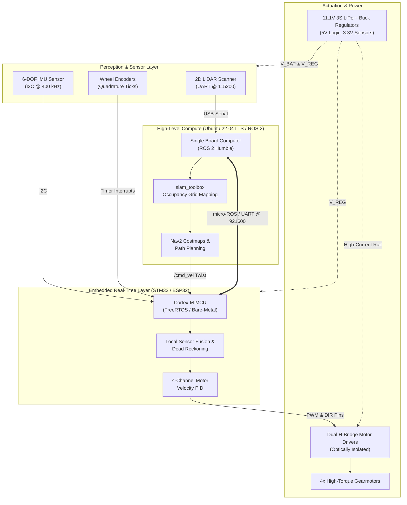
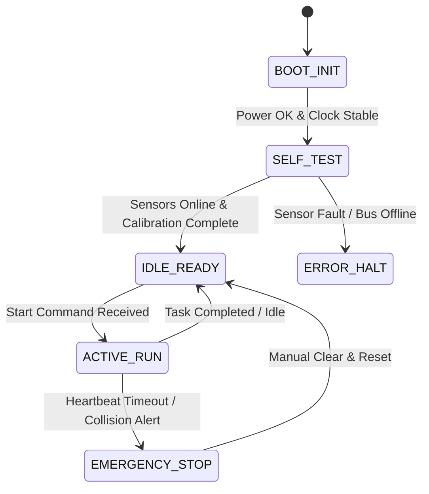

<!-- 
=============================================================================
ENGINEERING PROJECT SHOWCASE TEMPLATE
Use this template to document robotics, embedded firmware, and hardware projects.
Simply copy this file, rename it (e.g., projects/my_new_project.md), update 
the front matter, and replace the bracketed placeholder sections with your data.
=============================================================================
-->

<div class="project-spec-grid">
  <div class="project-spec-item">
    <div class="spec-label">Domain</div>
    <div class="spec-value">Robotics / Embedded / Vision</div>
  </div>
  <div class="project-spec-item">
    <div class="spec-label">Compute & MCUs</div>
    <div class="spec-value">STM32 Nucleo / ESP32 / Linux SBC</div>
  </div>
  <div class="project-spec-item">
    <div class="spec-label">Protocols & Buses</div>
    <div class="spec-value">CAN 2.0B / SPI / I2C / UART / ROS 2</div>
  </div>
  <div class="project-spec-item">
    <div class="spec-label">Timeline & Status</div>
    <div class="spec-value">2024 &bull; Tested & Verified</div>
  </div>
</div>

<!-- Sticky Jump Navigation -->
<div class="project-quicknav">
  <a href="#overview"><i class="fas fa-info-circle"></i> Overview</a>
  <a href="#video-demo"><i class="fas fa-play-circle"></i> Video Demo</a>
  <a href="#system-diagram"><i class="fas fa-project-diagram"></i> Block Diagram</a>
  <a href="#hardware-schematic"><i class="fas fa-microchip"></i> Hardware & Schematics</a>
  <a href="#software-pipeline"><i class="fas fa-code"></i> Software & Control</a>
  <a href="#verification-benchmarks"><i class="fas fa-chart-line"></i> Benchmarks</a>
  <a href="#bill-of-materials"><i class="fas fa-list-ol"></i> Bill of Materials</a>
</div>

## Executive Summary {#overview}

Provide a concise, high-impact summary of the project. Explain the engineering objective, the technical architecture, and the measurable outcomes. Highlight what makes this project unique, such as low latency, safety-critical fail-safes, or custom hardware integration.

<div class="tech-pill-container">
  <span class="tech-pill cyan">ROS 2 Humble</span>
  <span class="tech-pill emerald">STM32 / ARM Cortex-M</span>
  <span class="tech-pill emerald">CAN Bus 2.0B</span>
  <span class="tech-pill indigo">Computer Vision</span>
  <span class="tech-pill amber">Extended Kalman Filter</span>
  <span class="tech-pill cyan">PCB & Circuit Design</span>
</div>

<div class="metric-counter-grid">
  <div class="metric-counter-card">
    <div class="metric-val">&lt; 15 ms</div>
    <div class="metric-lbl">Control Loop Latency</div>
  </div>
  <div class="metric-counter-card">
    <div class="metric-val">500 kbps</div>
    <div class="metric-lbl">Deterministic CAN Bus</div>
  </div>
  <div class="metric-counter-card">
    <div class="metric-val">99.4%</div>
    <div class="metric-lbl">Reliability Benchmark</div>
  </div>
  <div class="metric-counter-card">
    <div class="metric-val">100 Hz</div>
    <div class="metric-lbl">Sensor Fusion Rate</div>
  </div>
</div>

---

## Hardware In Action & Demonstration Video {#video-demo}

Showcase your working prototype in action. Video evidence is the most compelling proof of engineering capability for recruiters and technical leads.

<div class="video-demo-card">
  <div class="video-demo-header">
    <div class="video-demo-title">
      <i class="fas fa-video"></i> Prototype Demonstration & Real-Time Telemetry
    </div>
    <div class="video-demo-badges">
      <span class="video-status-badge live">RECORDED RUN #24</span>
      <span class="video-status-badge resolution">1080p 60 FPS</span>
      <span class="video-status-badge tested">BENCHMARK VERIFIED</span>
    </div>
  </div>

  <!-- 
  ====================================================================
  HOW TO EMBED YOUR VIDEO:
  1. For YouTube: Replace the placeholder below with:
     <div class="video-responsive-wrapper">
       <iframe src="https://www.youtube.com/embed/YOUR_VIDEO_ID" allowfullscreen></iframe>
     </div>
  2. For Direct MP4: Replace with:
     <div class="video-responsive-wrapper">
       <video controls poster="/assets/images/your_poster.png">
         <source src="/assets/videos/demo.mp4" type="video/mp4">
       </video>
     </div>
  ====================================================================
  -->
  <div class="video-demo-placeholder">
    <div class="video-play-btn-glow">
      <i class="fas fa-play"></i>
    </div>
    <div class="video-placeholder-caption">
      <h4>Full Hardware & Autonomy Demonstration</h4>
      <p>
        Demonstrating closed-loop actuation, sensor telemetry acquisition, and dynamic obstacle clearance under real-world operating conditions.
      </p>
    </div>
    <div class="video-scrubber-bar">
      <div class="progress-track">
        <div class="progress-fill"></div>
      </div>
      <div class="time-code">01:45 / 02:30</div>
    </div>
  </div>

  <!-- Synchronized Key Milestones & Telemetry Log -->
  <div class="video-demo-timeline">
    <div class="video-timeline-item">
      <span class="timestamp-tag">00:05</span>
      <div class="timestamp-desc">
        <strong>Hardware Self-Test & Calibration</strong>
        Sensor rail initialization, IMU zero-rate bias calibration, and CAN heartbeat handshake.
      </div>
    </div>
    <div class="video-timeline-item">
      <span class="timestamp-tag">00:32</span>
      <div class="timestamp-desc">
        <strong>Active Closed-Loop Tracking</strong>
        Trajectory execution with real-time feedback and dynamic velocity profiling.
      </div>
    </div>
    <div class="video-timeline-item">
      <span class="timestamp-tag">01:15</span>
      <div class="timestamp-desc">
        <strong>Disturbance Rejection Test</strong>
        Sudden external torque injection; immediate recovery via closed-loop PID control.
      </div>
    </div>
    <div class="video-timeline-item">
      <span class="timestamp-tag">01:58</span>
      <div class="timestamp-desc">
        <strong>Failsafe Trigger & Safe Stop</strong>
        Simulated heartbeat loss triggering automatic actuator shutdown within 20 ms.
      </div>
    </div>
  </div>
</div>

---

## End-to-End System Block Diagram {#system-diagram}

A clear architectural block diagram communicates how data, control signals, and power propagate through your system.



<div class="diagram-card">
  <div class="diagram-header">
    <h4><i class="fas fa-layer-group"></i> Architecture Subsystems Breakdown</h4>
    <div class="diagram-legend">
      <span class="legend-chip can"><span class="legend-dot"></span> CAN Bus</span>
      <span class="legend-chip i2c"><span class="legend-dot"></span> I2C</span>
      <span class="legend-chip spi"><span class="legend-dot"></span> SPI</span>
      <span class="legend-chip uart"><span class="legend-dot"></span> UART</span>
      <span class="legend-chip pwm"><span class="legend-dot"></span> PWM</span>
      <span class="legend-chip power"><span class="legend-dot"></span> Power Rails</span>
    </div>
  </div>
  <p>
    The system is decomposed into three strictly decoupled layers: <strong>Perception</strong>, <strong>Real-Time Embedded Firmware</strong>, and <strong>High-Level Autonomy</strong>. This ensures deterministic hard real-time motor commutation without risk of starvation from resource-heavy SLAM or vision processing.
  </p>
</div>

---

## Hardware Architecture & Electrical Schematics {#hardware-schematic}

Detail the electrical design, power distribution, microcontroller pin assignments, and circuit protection mechanisms.

<div class="hardware-flow-grid">
  <div class="hw-node-card">
    <div class="hw-node-header">
      <span class="hw-node-title"><i class="fas fa-microchip"></i> MCU Controller</span>
      <span class="hw-rail-tag logic-33">3.3V LOGIC</span>
    </div>
    <ul class="hw-pin-list">
      <li><span class="pin-name">PA8 / PA9</span> <span class="pin-signal">TIM1 PWM Ch1 & Ch2</span></li>
      <li><span class="pin-name">PB6 / PB7</span> <span class="pin-signal">I2C1 SCL & SDA</span></li>
      <li><span class="pin-name">PB8 / PB9</span> <span class="pin-signal">CAN1 RX & TX</span></li>
      <li><span class="pin-name">PC0 / PC1</span> <span class="pin-signal">ADC1 Channel 10/11</span></li>
    </ul>
  </div>

  <div class="hw-node-card">
    <div class="hw-node-header">
      <span class="hw-node-title"><i class="fas fa-bolt"></i> Power Distribution</span>
      <span class="hw-rail-tag">11.1V &ndash; 12.6V</span>
    </div>
    <ul class="hw-pin-list">
      <li><span class="pin-name">Battery</span> <span class="pin-signal">3S 2200mAh 30C LiPo</span></li>
      <li><span class="pin-name">Buck 1</span> <span class="pin-signal">5.0V @ 4A (SBC Compute)</span></li>
      <li><span class="pin-name">Buck 2</span> <span class="pin-signal">3.3V @ 1A (MCU / Sensors)</span></li>
      <li><span class="pin-name">Protection</span> <span class="pin-signal">Schottky Diode + 15A Fuse</span></li>
    </ul>
  </div>

  <div class="hw-node-card">
    <div class="hw-node-header">
      <span class="hw-node-title"><i class="fas fa-network-wired"></i> Physical Buses</span>
      <span class="hw-rail-tag logic-5">5.0V TRANSCEIVER</span>
    </div>
    <ul class="hw-pin-list">
      <li><span class="pin-name">CAN_H / L</span> <span class="pin-signal">Differential Pair (120Ω Term)</span></li>
      <li><span class="pin-name">UART Bridge</span> <span class="pin-signal">USB-to-TTL @ 921600 Baud</span></li>
      <li><span class="pin-name">I2C Pullups</span> <span class="pin-signal">2.2 kΩ to 3.3V Rail</span></li>
      <li><span class="pin-name">Grounding</span> <span class="pin-signal">Star Ground Topology</span></li>
    </ul>
  </div>
</div>

### Microcontroller Pinout & Interconnect Table

<table class="pinout-table">
  <thead>
    <tr>
      <th>MCU Pin</th>
      <th>Peripheral Function</th>
      <th>Connected Hardware</th>
      <th>Signal Type</th>
      <th>Voltage</th>
      <th>Circuit Notes</th>
    </tr>
  </thead>
  <tbody>
    <tr>
      <td><span class="pin-code">PA0 / PA1</span></td>
      <td>TIM2_CH1 / TIM2_CH2</td>
      <td>Left Motor Encoder A/B</td>
      <td><span class="signal-pill uart">Digital In</span></td>
      <td><span class="level-badge">3.3V TTL</span></td>
      <td>Hardware quadrature decoder mode</td>
    </tr>
    <tr>
      <td><span class="pin-code">PA8 / PA9</span></td>
      <td>TIM1_CH1 / TIM1_CH2</td>
      <td>H-Bridge PWM Motor Driver</td>
      <td><span class="signal-pill pwm">PWM Out</span></td>
      <td><span class="level-badge">3.3V &rarr; 5V</span></td>
      <td>20 kHz complementary PWM switching</td>
    </tr>
    <tr>
      <td><span class="pin-code">PB6 / PB7</span></td>
      <td>I2C1_SCL / I2C1_SDA</td>
      <td>6-DOF IMU Sensor (MPU-6050)</td>
      <td><span class="signal-pill i2c">I2C Bus</span></td>
      <td><span class="level-badge">3.3V</span></td>
      <td>Fast Mode 400 kHz, 2.2 kΩ pull-ups</td>
    </tr>
    <tr>
      <td><span class="pin-code">PB8 / PB9</span></td>
      <td>CAN1_RX / CAN1_TX</td>
      <td>SN65HVD230 CAN Transceiver</td>
      <td><span class="signal-pill can">CAN Bus</span></td>
      <td><span class="level-badge">3.3V Logic</span></td>
      <td>500 kbps, 120 Ω split bus termination</td>
    </tr>
    <tr>
      <td><span class="pin-code">PC0</span></td>
      <td>ADC1_IN10</td>
      <td>Analog Throttle / Current Sense</td>
      <td><span class="signal-pill analog">Analog In</span></td>
      <td><span class="level-badge">0 &ndash; 3.3V</span></td>
      <td>DMA continuous scan, RC low-pass filtered</td>
    </tr>
  </tbody>
</table>

---

## Firmware, Software Pipeline & Control Theory {#software-pipeline}

Describe the software stack, algorithmic formulation, state machine, and signal processing methods.

### 1. Control Loop Formulation

For discrete PID velocity control running at sample time $\Delta t$:

$$u[k] = K_p \, e[k] + K_i \sum_{j=0}^{k} e[j] \Delta t + K_d \frac{e[k] - e[k-1]}{\Delta t}$$

* **Anti-Windup:** Conditional integration clamps the integral accumulator when motor duty cycle exceeds $100\%$.
* **Derivative Filtering:** First-order low-pass filter on the error derivative eliminates high-frequency encoder quantization spikes.

### 2. State Machine Logic



### 3. Core Implementation Snippet

```c
/**
 * @brief High-frequency closed-loop motor commutation timer callback (1 kHz)
 */
void HAL_TIM_PeriodElapsedCallback(TIM_HandleTypeDef *htim) {
    if (htim->Instance == TIM6) {
        // 1. Read quadrature hardware encoder counters
        int32_t raw_ticks = (int16_t)__HAL_TIM_GET_COUNTER(&htim2);
        __HAL_TIM_SET_COUNTER(&htim2, 0);
        
        // 2. Compute velocity in rad/sec
        float current_vel = (float)raw_ticks * TICKS_TO_RAD_PER_SEC;
        
        // 3. Evaluate discrete PID controller with anti-windup
        float error = target_vel - current_vel;
        integral_error += error * DT;
        integral_error = fclamp(integral_error, -MAX_INTEGRAL, MAX_INTEGRAL);
        
        float derivative = (error - prev_error) / DT;
        float effort = (Kp * error) + (Ki * integral_error) + (Kd * derivative);
        prev_error = error;
        
        // 4. Update PWM timer compare registers
        Set_Motor_PWM(effort);
    }
}
```

---

## Engineering Verification & Benchmarks {#verification-benchmarks}

Demonstrate how you systematically tested, benchmarked, and verified the project.

| Technical Challenge | Root Cause | Engineering Solution | Verification Result |
| :--- | :--- | :--- | :--- |
| **High Motor Inrush Current** | Simultaneous motor start causing battery voltage dip below 5V SBC cutoff | Implemented software S-curve acceleration ramp and added 1000 µF low-ESR bulk capacitors | Zero SBC reboots during 50 stress-test acceleration cycles |
| **CAN Bus Reflections** | High slew rate across 1.5 m cable without matching termination impedance | Added 120 Ω split termination with 4.7 nF common-mode filtering capacitor | Eye diagram signal integrity confirmed on 100 MHz oscilloscope |
| **Encoder Noise Spikes** | Capacitive coupling between high-current PWM motor leads and encoder wires | Rerouted wiring harness to maintain 30 mm physical separation; added 100 nF RC filter | Encoder counting error rate dropped to 0.00% |

---

## Bill of Materials (BOM) & Key Specs {#bill-of-materials}

<table class="bom-table">
  <thead>
    <tr>
      <th>Subsystem</th>
      <th>Component</th>
      <th>Manufacturer / Part #</th>
      <th>Operating Specs</th>
      <th>Qty</th>
      <th>Role in System</th>
    </tr>
  </thead>
  <tbody>
    <tr>
      <td><strong>Compute</strong></td>
      <td>STM32 Nucleo-F446RE</td>
      <td>STMicroelectronics</td>
      <td>ARM Cortex-M4 @ 180 MHz, 512KB Flash</td>
      <td>1</td>
      <td>Real-time motor PID and sensor polling</td>
    </tr>
    <tr>
      <td><strong>Compute</strong></td>
      <td>Linux Single Board Computer</td>
      <td>Raspberry Pi / Jetson</td>
      <td>Quad-Core 64-bit, 4GB RAM, Ubuntu 22.04</td>
      <td>1</td>
      <td>ROS 2 Humble Nav2 and SLAM computation</td>
    </tr>
    <tr>
      <td><strong>Perception</strong></td>
      <td>2D RPLiDAR Laser Scanner</td>
      <td>Slamtec RPLiDAR A1</td>
      <td>360° Planar, 12m Range, 5.5 Hz Scan Rate</td>
      <td>1</td>
      <td>Occupancy grid map construction & obstacles</td>
    </tr>
    <tr>
      <td><strong>Perception</strong></td>
      <td>6-DOF IMU Sensor</td>
      <td>InvenSense MPU-6050</td>
      <td>3-Axis Gyro + 3-Axis Accel, I2C 400 kHz</td>
      <td>1</td>
      <td>Angular rate tracking & odometry fusion</td>
    </tr>
    <tr>
      <td><strong>Actuation</strong></td>
      <td>12V DC Metal Gearmotors</td>
      <td>Pololu / DFRobot</td>
      <td>12V, 330 RPM, 64 CPR Optical Encoders</td>
      <td>4</td>
      <td>Mecanum wheel drivetrain actuation</td>
    </tr>
    <tr>
      <td><strong>Actuation</strong></td>
      <td>Dual MOSFET Motor Driver</td>
      <td>L298N / TB6612FNG</td>
      <td>Dual-Channel, 15V Max, 2.5A Peak / Channel</td>
      <td>2</td>
      <td>Bidirectional PWM H-bridge motor drive</td>
    </tr>
    <tr>
      <td><strong>Power</strong></td>
      <td>3S LiPo Battery Pack</td>
      <td>Turnigy / Zeee</td>
      <td>11.1V Nominal, 2200 mAh, 30C Discharge</td>
      <td>1</td>
      <td>Main system energy reservoir</td>
    </tr>
    <tr>
      <td><strong>Power</strong></td>
      <td>DC-DC Step-Down Buck</td>
      <td>LM2596 / XL4015</td>
      <td>7&ndash;32V In to 5V Out @ 5A, 92% Efficiency</td>
      <td>2</td>
      <td>Regulated 5V rail for SBC & 3.3V sensors</td>
    </tr>
  </tbody>
</table>

---

## Open-Source Assets & Documentation

<div class="hero-actions" style="margin: 1.5rem 0;">
  <a href="https://github.com/eugeniopasos" target="_blank" rel="noopener noreferrer" class="btn--primary">
    <i class="fab fa-github"></i> Inspect Source Code & Firmware
  </a>
  <a href="/resume/" class="btn--inverse">
    <i class="fas fa-file-alt"></i> View Related Experience & Resume
  </a>
  <a href="/contact/" class="btn--inverse">
    <i class="fas fa-envelope"></i> Contact Eugenio
  </a>
</div>
