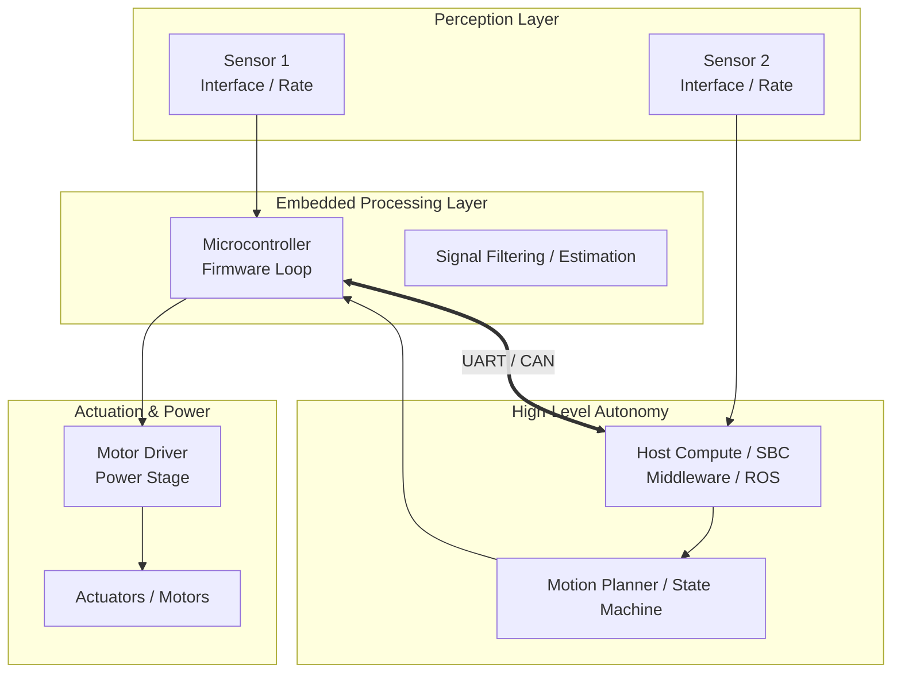

<!-- 
=============================================================================
ENGINEERING PROJECT SHOWCASE TEMPLATE
Copy this file, update the front matter, and replace the bracketed sections.
=============================================================================
-->

<div class="project-meta-strip">
  <div class="meta-item"><span class="meta-label">Domain:</span> <span class="meta-val">[Robotics / Embedded / Vision]</span></div>
  <div class="meta-item"><span class="meta-label">Timeline:</span> <span class="meta-val">[2024 &bull; Completed]</span></div>
  <div class="meta-item"><span class="meta-label">Stack:</span> <span class="meta-val">[ROS 2, STM32, C++, Python]</span></div>
  <div class="meta-item"><span class="meta-label">Hardware:</span> <span class="meta-val">[Microcontroller, Sensors, Actuators]</span></div>
</div>

## Overview

[Provide a concise, 2-3 sentence summary of the project engineering objective, architecture, and primary results.]

<div class="tech-pill-container">
  <span class="tech-pill">[Core Tech 1]</span>
  <span class="tech-pill">[Core Tech 2]</span>
  <span class="tech-pill">[Core Tech 3]</span>
  <span class="tech-pill">[Protocol / Bus]</span>
</div>

---

## Demonstration & Telemetry

<div class="video-showcase-container">
  <div class="video-showcase-header">
    <span>[Prototype Demonstration Title]</span>
    <span style="font-weight: 400; color: var(--text-muted); font-size: 0.8rem;">[Operating Condition / Rate]</span>
  </div>

  <!-- Video Player / Embed: Swap in your YouTube iframe or video tag -->
  <div class="video-responsive-wrapper">
    <div class="video-placeholder-card">
      <div class="play-icon-box">
        <i class="fas fa-play"></i>
      </div>
      <h4>[Video Demonstration Title]</h4>
      <p>
        [Brief description of what is demonstrated in the clip — closed-loop actuation, sensor telemetry, and dynamic edge-case handling.]
      </p>
    </div>
  </div>

  <div class="milestones-list">
    <div class="milestone-item">
      <span class="time-badge">0:05</span>
      <strong>[Milestone 1]:</strong> [Description of startup, initialization, or self-test.]
    </div>
    <div class="milestone-item">
      <span class="time-badge">0:30</span>
      <strong>[Milestone 2]:</strong> [Description of closed-loop operation.]
    </div>
    <div class="milestone-item">
      <span class="time-badge">1:00</span>
      <strong>[Milestone 3]:</strong> [Description of disturbance rejection or obstacle maneuver.]
    </div>
    <div class="milestone-item">
      <span class="time-badge">1:30</span>
      <strong>[Milestone 4]:</strong> [Description of goal pose arrival or failsafe trigger.]
    </div>
  </div>
</div>

---

## System Architecture

[Explain the high-level system decomposition and data flow.]



---

## Hardware Architecture & Electrical Interface

[Describe the electrical design, power distribution rails, and noise isolation mechanisms.]

### Pinout & Interconnect Table

| MCU Pin | Peripheral Function | Connected Hardware | Signal Type | Voltage | Notes |
| :--- | :--- | :--- | :--- | :--- | :--- |
| <span class="pin-code">[Pin 1]</span> | [TIM_PWM] | [Motor Driver] | PWM Out | 3.3V Logic | [Switching frequency / isolation] |
| <span class="pin-code">[Pin 2]</span> | [I2C_SCL/SDA] | [Sensor Module] | I2C Bus | 3.3V | [Clock speed / pull-up values] |
| <span class="pin-code">[Pin 3]</span> | [CAN_TX/RX] | [CAN Transceiver] | CAN Bus | 3.3V TTL | [Baud rate / termination] |
| <span class="pin-code">[Pin 4]</span> | [ADC_IN] | [Analog Input] | Analog In | 0 &ndash; 3.3V | [Filtering / DMA mode] |

---

## Software Pipeline & Algorithms

[Formulate the core mathematical models, kinematic transforms, or state machine logic.]

### 1. Mathematical Formulation

$$u[k] = K_p \, e[k] + K_i \sum_{j=0}^{k} e[j] \Delta t + K_d \frac{e[k] - e[k-1]}{\Delta t}$$

### 2. Implementation Highlight

```c
// Core execution loop or critical ISR callback
void System_Control_Loop(void) {
    // 1. Read sensor inputs
    // 2. Evaluate state machine or feedback controller
    // 3. Command actuators with safety bounds
}
```

---

## Engineering Challenges & Verification

| Challenge | Root Cause | Engineering Solution | Verification Result |
| :--- | :--- | :--- | :--- |
| **[Challenge 1]** | [Root physical or software cause] | [Implemented engineering fix] | [Quantified outcome] |
| **[Challenge 2]** | [Root physical or software cause] | [Implemented engineering fix] | [Quantified outcome] |
| **[Challenge 3]** | [Root physical or software cause] | [Implemented engineering fix] | [Quantified outcome] |

---

## Bill of Materials (BOM)

| Subsystem | Component | Part # / Spec | Qty | Function |
| :--- | :--- | :--- | :--- | :--- |
| **Compute** | [MCU / SBC] | [Processor, Flash, RAM] | 1 | [System role] |
| **Perception** | [Sensor 1] | [Operating specs] | 1 | [Sensing function] |
| **Actuation** | [Motor / Driver] | [Torque / Voltage specs] | 1 | [Actuation role] |
| **Power** | [Battery / Regulator] | [Voltage, current capacity] | 1 | [Power rail delivery] |

---

<div class="hero-actions" style="margin-top: 2rem;">
  <a href="https://github.com/eugeniopasos" target="_blank" rel="noopener noreferrer" class="btn--primary">
    <i class="fab fa-github"></i> View GitHub Repository
  </a>
  <a href="/#projects" class="btn--inverse">
    &larr; Back to Projects
  </a>
</div>
